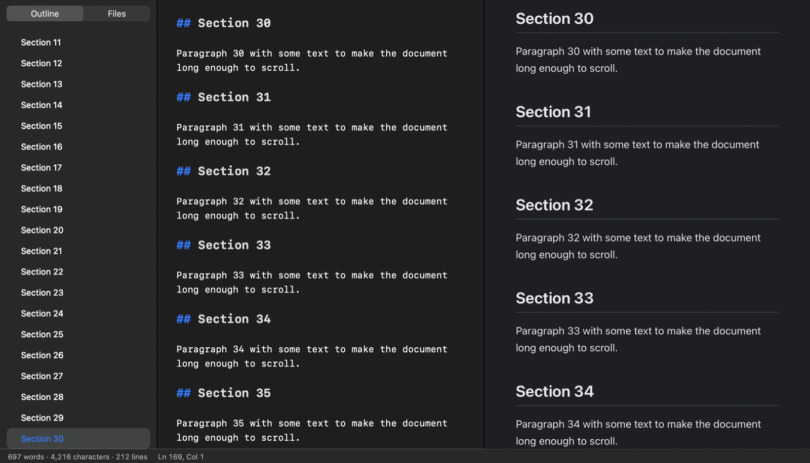

# Z-MarkDowner

**A native macOS Markdown editor and viewer with Word/PDF/EPUB export and DOCX/DOC/RTF import.**

[English](#english) · [Magyar](#magyar)



---

## English

Z-MarkDowner is a fast, native (AppKit) Markdown editor for macOS. Write in a syntax-highlighted source editor, look at the rendered result side by side or in a clean *final view*, and export to PDF, Word, HTML or EPUB — or open Word and RTF documents and continue them in Markdown.

### Features

**Editing**
- Syntax-highlighted Markdown editor with toolbar and menu commands for bold, italic, strikethrough, code, headings (H1–H6), bulleted / numbered / task lists, quotes, links, images, tables, code blocks, footnotes, formulas and diagrams
- Smart editing: lists continue on Return, Tab / Shift-Tab indent, auto-closing brackets and quotes
- Table editor: Tab jumps between cells and aligns the columns, Return adds a row, commands to insert/delete rows and columns and to set column alignment
- Paste or drag images: screenshots are saved into an `images/` folder next to the document; dropped image files are referenced or copied there
- *Paste as Markdown* converts rich text copied from Word or a web page; *Copy as Formatted Text* goes the other way (for Mail, Word, Pages)
- Focus mode, typewriter scrolling, adjustable font, size and line width, spell checking that skips code, URLs and formulas
- **Live formatting** (⌥⌘L): WYSIWYG-like editing — Markdown markup is hidden except on the line you are editing; headings, bold, links, bullets, checkboxes (clickable), rules and quotes look like the final document
- **Folder search and replace** in all Markdown / text files of a folder (case, whole word, regular expressions with `$1` groups)
- **Statistics and goals**: words, characters, sentences, reading and speaking time, per-document and daily word goals

**Scholarly writing**
- **Citations** `[@key]`, `[see @key, p. 5; @other]`, `@key` from BibTeX or CSL-JSON (e.g. Zotero) — **Vancouver** or **APA 7**, automatic reference list
- **Insert Citation** (⌃⌘C): search the bibliography or add a reference by **DOI** or **PubMed ID**; `@` autocompletes keys
- **Cross-references**: numbered figures `{#fig:…}`, tables `{#tbl:…}`, equations `{#eq:…}` and sections `{#sec:…}`, referenced with `@fig:…`
- **Table of contents** (`[TOC]` / `toc: true`) and numbered headings (`numbersections: true`) — with page numbers in PDF, a real TOC field in Word
- **Word templates** (.dotx / .docx): styles (matched by name, also in localized Word), page setup, headers and footers
- **Review**: Word tracked changes and comments are imported as CriticMarkup (`{++…++}`, `{--…--}`, `{==…==}{>>…<<}`), can be accepted / rejected, and are exported back to Word as tracked changes and comments

**Viewing**
- Three views: editor, split view and final (rendered) view — plus native full screen
- Synchronized scrolling between editor and preview in both directions
- Sidebar with a document outline (click a heading to jump) and a folder browser
- Preview styles: GitHub, Academic, Minimal — plus your own custom CSS
- Light / dark appearance

**Markdown dialect**
- CommonMark basics plus GitHub extensions: tables, task lists, strikethrough, autolinks
- Footnotes (`[^1]`), YAML front matter (title, subtitle, author, date, keywords)
- Math with KaTeX (`$…$`, `$$…$$`) and Mermaid diagrams (```` ```mermaid ````)
- Syntax highlighting for 20+ languages in code blocks

**Import** — DOCX (own reader: Word styles, numbering, hyperlinks, tables, footnotes), DOC, RTF, ODT, HTML, TXT (UTF-8 / UTF-16 / Windows-1250 / Latin-2 detection) and MD. Imported files open as new Markdown documents, so the original is never overwritten.

**Export**
- **PDF** – rendered with the same engine as the preview, paginated at line boundaries (A4 or US Letter, page numbers), clickable links and cross-references
- **Word (DOCX)** – real Word styles (headings, title, lists with numbering, tables, code, quotes), real Word footnotes, embedded images
- **HTML** (self-contained) and **EPUB 3** e-books with a table of contents
- **Batch conversion** of whole folders, and **Finder Services** (“Convert to PDF / Word / Markdown”)
- **Quick Look** extension: press Space on a `.md` file in Finder to see it rendered
- Printing (⌘P) uses the rendered output

**Languages** — English, Magyar, Deutsch, Español, Italiano, Français, Português, Русский, Slovenčina, Čeština, Română, Türkçe (Settings ▸ General ▸ Language).

### Requirements

- macOS 13 Ventura or later (Apple silicon or Intel)
- To build: Xcode 15+ / Swift 5.9+ command line tools

### Build and install

```bash
git clone https://github.com/ZoliQua/Z-MarkDowner.git
cd Z-MarkDowner
./build.sh            # builds build/Z-MarkDowner.app
./build.sh install    # copies it to /Applications and registers Quick Look + Services
./build.sh dmg        # creates build/Z-MarkDowner-<version>.dmg
./build.sh test       # unit tests + end-to-end self test of the built app
```

The app is ad-hoc signed by default. For distribution, sign and notarize with a Developer ID:

```bash
DEVELOPER_ID="Developer ID Application: …" NOTARY_PROFILE=<keychain-profile> ./build.sh notarize
```

You can also open `Package.swift` in Xcode.

### Keyboard shortcuts

| Action | Shortcut |
|:--|:--:|
| Editor / Split view / Final view | ⌘1 / ⌘2 / ⌘3 |
| Full screen | ⌃⌘F |
| Sidebar | ⌃⌘S |
| Bold / Italic / Link | ⌘B / ⌘I / ⌘K |
| Heading 1–6 / Normal text | ⌥⌘1–6 / ⌥⌘0 |
| Bulleted / Numbered / Task list | ⇧⌘8 / ⇧⌘7 / ⇧⌘9 |
| Insert table / Align table | ⌥⌘T / ⇧⌥⌘T |
| Export PDF / Word | ⇧⌘E / ⇧⌘D |
| Focus mode / Typewriter scrolling | ⇧⌘F / ⌃⌘T |
| Paste as Markdown / Copy as formatted text | ⇧⌥⌘V / ⇧⌥⌘C |
| Insert citation / cross-reference | ⌃⌘C / ⌃⌘R |
| Insert comment | ⇧⌘K |
| Live formatting / Statistics | ⌥⌘L / ⌥⌘S |
| Search in folder | ⇧⌥⌘F |

### Project structure

| Path | Contents |
|:--|:--|
| `Sources/MarkDownerCore` | Markdown parser, HTML/DOCX/EPUB writers, DOCX reader, importers, PDF pagination (testable library) |
| `Sources/ZMarkDowner` | The AppKit application (documents, editor, preview, sidebar, settings, services, self test) |
| `Sources/ZMarkDownerQuickLook` | Quick Look preview extension |
| `Resources/Localization` | Translations (`Localizable.strings`, `Help.md`, `ServicesMenu.strings`) |
| `Resources/Web` | Bundled KaTeX and Mermaid |
| `Tests` | Unit tests and fixture documents |

To add a translation, run `python3 scripts/extract_strings.py` to refresh the English table, then copy `Resources/Localization/en.lproj` to `<code>.lproj` and translate it.

### Contributing

Issues and pull requests are welcome. Please run `./build.sh test` before submitting, keep the code style of the surrounding code, and follow the [Code of Conduct](CODE_OF_CONDUCT.md). Contributors are listed in [CONTRIBUTORS.md](CONTRIBUTORS.md); changes are tracked in [CHANGELOG.md](CHANGELOG.md).

### License

[BSD 3-Clause License](LICENSE) © 2026 Dr. Dul Zoltán. Bundled third-party components (KaTeX, Mermaid) are MIT licensed — see [THIRD_PARTY_NOTICES.md](THIRD_PARTY_NOTICES.md).

---

## Magyar

A Z-MarkDowner gyors, natív (AppKit) Markdown-szerkesztő macOS-re. Szintaxiskiemelős forrásszerkesztőben írhatsz, a végeredményt egymás mellett vagy letisztult *végleges nézetben* láthatod, és PDF-be, Wordbe, HTML-be vagy EPUB-ba exportálhatsz. Word- és RTF-dokumentumokat is megnyithatsz, és Markdownban folytathatod őket.

### Funkciók

**Szerkesztés**
- Szintaxiskiemelős Markdown-szerkesztő eszköztárral és menüparancsokkal: félkövér, dőlt, áthúzott, kód, címsorok (H1–H6), felsorolás / számozott / feladatlista, idézet, link, kép, táblázat, kódblokk, lábjegyzet, képlet és diagram
- Okos szerkesztés: a lista Enterre folytatódik, Tab / Shift-Tab behúz, a zárójelek és idézőjelek automatikusan bezáródnak
- Táblázatszerkesztő: a Tab cellák között lép és igazítja az oszlopokat, az Enter új sort ad, sorok/oszlopok beszúrása, törlése, oszlopigazítás
- Képek beillesztése vagy behúzása: a képernyőképek a dokumentum melletti `images/` mappába kerülnek
- *Beillesztés Markdownként* a Wordből vagy weboldalról másolt formázott szöveghez, *Másolás formázott szövegként* a Mailhez, Wordhöz, Pageshez
- Fókusz mód, írógép-görgetés, állítható betűtípus, méret és sorszélesség, helyesírás-ellenőrzés (a kódot, URL-eket és képleteket kihagyja)
- **Élő formázás** (⌥⌘L): szövegszerkesztő-szerű szerkesztés – a Markdown-jelölés csak a szerkesztett sorban látszik; a címsorok, a félkövér, a linkek, a felsorolásjelek, a (kattintható) jelölőnégyzetek, a vonalak és az idézetek a végleges dokumentumhoz hasonlóan jelennek meg
- **Keresés és csere egy mappában** az összes Markdown- és szövegfájlban (kis- és nagybetű, teljes szó, reguláris kifejezés `$1` csoportokkal)
- **Statisztika és célok**: szavak, karakterek, mondatok, olvasási és felolvasási idő, dokumentum- és napi szócél

**Tudományos írás**
- **Hivatkozások** `[@kulcs]`, `[lásd @kulcs, p. 5; @masik]`, `@kulcs` BibTeX vagy CSL-JSON forrásból (pl. Zotero) – **Vancouver** vagy **APA 7** stílus, automatikus irodalomjegyzék
- **Hivatkozás beszúrása** (⌃⌘C): keresés az irodalomjegyzékben vagy új tétel **DOI** vagy **PubMed-azonosító** alapján; a `@` után a kulcsok automatikusan kiegészülnek
- **Kereszthivatkozások**: számozott ábrák `{#fig:…}`, táblázatok `{#tbl:…}`, egyenletek `{#eq:…}` és fejezetek `{#sec:…}`, hivatkozás rájuk: `@fig:…`
- **Tartalomjegyzék** (`[TOC]` / `toc: true`) és címsorszámozás (`numbersections: true`) – PDF-ben oldalszámokkal, Wordben valódi tartalomjegyzék-mezővel
- **Word-sablonok** (.dotx / .docx): stílusok (név szerint párosítva, magyar Wordben is), oldalbeállítás, élőfej és élőláb
- **Véleményezés**: a Word követett változásai és megjegyzései CriticMarkup-jelölésként (`{++…++}`, `{--…--}`, `{==…==}{>>…<<}`) kerülnek be, elfogadhatók / elvethetők, és Word-exportnál újra követett változások és megjegyzések lesznek

**Megjelenítés**
- Három nézet: szerkesztő, osztott és végleges (renderelt) nézet, valamint natív teljes képernyő
- Szinkronizált görgetés a szerkesztő és az előnézet között, mindkét irányban
- Oldalsáv tartalomjegyzékkel (kattintásra a címsorhoz ugrik) és mappaböngészővel
- Előnézeti stílusok: GitHub, Akadémiai, Minimál, valamint saját CSS
- Világos / sötét megjelenés

**Markdown-nyelvjárás**
- CommonMark alapok és GitHub-bővítmények: táblázatok, feladatlisták, áthúzás, automatikus linkek
- Lábjegyzetek (`[^1]`), YAML front matter (cím, alcím, szerző, dátum, kulcsszavak)
- Képletek KaTeX-szel (`$…$`, `$$…$$`) és Mermaid-diagramok (```` ```mermaid ````)
- Kódkiemelés több mint 20 nyelvhez

**Import**: DOCX (saját olvasó: Word-stílusok, számozás, linkek, táblázatok, lábjegyzetek), DOC, RTF, ODT, HTML, TXT (UTF-8 / UTF-16 / Windows-1250 / Latin-2 felismerés) és MD. Az importált fájl új Markdown-dokumentumként nyílik meg, az eredetit sosem írja felül.

**Export**
- **PDF**: ugyanazzal a motorral renderelve, mint az előnézet, sorhatárokon tördelve (A4 vagy US Letter, oldalszámok), kattintható linkekkel és kereszthivatkozásokkal
- **Word (DOCX)**: valódi Word-stílusok (címsorok, cím, számozott listák, táblázatok, kód, idézet), valódi Word-lábjegyzetek, beágyazott képek
- **HTML** (önálló fájl) és **EPUB 3** e-könyv tartalomjegyzékkel
- **Kötegelt konvertálás** egész mappákra, és **Finder-szolgáltatások** („Konvertálás PDF-be / Wordbe / Markdownba”)
- **Quick Look** bővítmény: a Finderben szóközzel formázva látszik a `.md` fájl
- A nyomtatás (⌘P) a renderelt eredményt nyomtatja

**Nyelvek**: angol, magyar, német, spanyol, olasz, francia, portugál, orosz, szlovák, cseh, román, török (Beállítások ▸ Általános ▸ Nyelv).

### Követelmények

- macOS 13 Ventura vagy újabb (Apple silicon vagy Intel)
- Fordításhoz: Xcode 15+ / Swift 5.9+ parancssori eszközök

### Fordítás és telepítés

```bash
git clone https://github.com/ZoliQua/Z-MarkDowner.git
cd Z-MarkDowner
./build.sh            # elkészíti: build/Z-MarkDowner.app
./build.sh install    # bemásolja az /Applications mappába, regisztrálja a Quick Lookot és a szolgáltatásokat
./build.sh dmg        # elkészíti: build/Z-MarkDowner-<verzió>.dmg
./build.sh test       # unit tesztek + a kész app végponttól végpontig tartó öntesztje
```

Alapból ad-hoc aláírással készül. Terjesztéshez Developer ID-vel írd alá és hitelesíttesd:

```bash
DEVELOPER_ID="Developer ID Application: …" NOTARY_PROFILE=<keychain-profil> ./build.sh notarize
```

A `Package.swift` Xcode-ban is megnyitható.

### Billentyűparancsok

| Művelet | Billentyű |
|:--|:--:|
| Szerkesztő / Osztott / Végleges nézet | ⌘1 / ⌘2 / ⌘3 |
| Teljes képernyő | ⌃⌘F |
| Oldalsáv | ⌃⌘S |
| Félkövér / Dőlt / Link | ⌘B / ⌘I / ⌘K |
| Címsor 1–6 / Normál szöveg | ⌥⌘1–6 / ⌥⌘0 |
| Felsorolás / Számozott / Feladatlista | ⇧⌘8 / ⇧⌘7 / ⇧⌘9 |
| Táblázat beszúrása / igazítása | ⌥⌘T / ⇧⌥⌘T |
| Exportálás PDF / Word | ⇧⌘E / ⇧⌘D |
| Fókusz mód / Írógép-görgetés | ⇧⌘F / ⌃⌘T |
| Beillesztés Markdownként / Másolás formázott szövegként | ⇧⌥⌘V / ⇧⌥⌘C |
| Hivatkozás / kereszthivatkozás beszúrása | ⌃⌘C / ⌃⌘R |
| Megjegyzés beszúrása | ⇧⌘K |
| Élő formázás / Statisztika | ⌥⌘L / ⌥⌘S |
| Keresés a mappában | ⇧⌥⌘F |

### Közreműködés

Hibajegyeket és pull requesteket szívesen fogadunk. Beküldés előtt futtasd a `./build.sh test` parancsot, igazodj a környező kód stílusához, és tartsd be a [magatartási kódexet](CODE_OF_CONDUCT.md). Új fordítás felvétele: `python3 scripts/extract_strings.py`, majd a `Resources/Localization/en.lproj` mappát másold `<kód>.lproj` néven, és fordítsd le.

### Licenc

[BSD 3-Clause licenc](LICENSE) © 2026 Dr. Dul Zoltán. A mellékelt külső komponensek (KaTeX, Mermaid) MIT-licencesek, lásd: [THIRD_PARTY_NOTICES.md](THIRD_PARTY_NOTICES.md).

---

*Author / Szerző: **Dr. Dul Zoltán** · GitHub: [ZoliQua](https://github.com/ZoliQua)*
