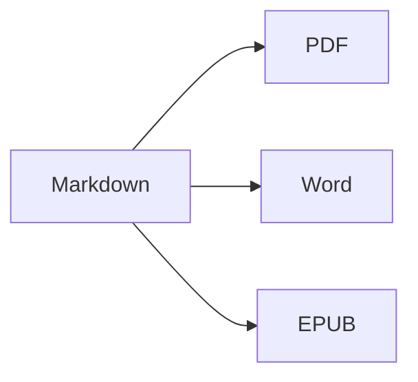

Otevřete **rozdělené zobrazení** (⌘2) a uvidíte zdrojový text i výsledek vedle sebe.

## Formátování textu

- **Tučné** – `**text**` (⌘B)
- *Kurzíva* – `*text*` (⌘I)
- ~~Přeškrtnuté~~ – `~~text~~` (⇧⌘X)
- `Kód` – `` `kód` `` (⌘`)
- [Odkaz](https://cs.wikipedia.org/wiki/Markdown) – `[text](adresa)` (⌘K)

## Nadpisy

`# Nadpis 1` … `###### Nadpis 6` (⌥⌘1 … ⌥⌘6). **Boční panel** (⌃⌘S) je zobrazuje jako osnovu.

## Seznamy

1. Číslovaný seznam (⇧⌘7)
2. Druhá položka
    - Vnořená položka (odsazení klávesou Tab)

- [x] Hotovo
- [ ] Zbývá udělat (⇧⌘9)

> Citace (⇧⌘')

## Tabulky

| Funkce | Zkratka |
|:--------|:--------:|
| Editor | ⌘1 |
| Rozdělené zobrazení | ⌘2 |
| Konečné zobrazení | ⌘3 |
| Celá obrazovka | ⌃⌘F |

V tabulce **Tab** přeskočí do další buňky a zarovná sloupce; **Return** přidá řádek.

## Kód

```swift
func greet(_ name: String) -> String {
    return "Ahoj, \(name)!"   // zvýrazněná syntaxe
}
```

## Poznámky pod čarou

Markdown podporuje poznámky pod čarou[^1].

[^1]: Text poznámky se zobrazí na konci dokumentu – a ve Wordu jako skutečná poznámka pod čarou.

## Vzorce a diagramy

V řádku: $e^{i\pi} + 1 = 0$

$$
\int_0^1 x^2\,dx = \frac{1}{3}
$$



## Obrázky

Vložte snímek obrazovky (⌘V) nebo do editoru přetáhněte obrázek: uloží se do složky `images` vedle dokumentu.

---

**Export:** Soubor ▸ Exportovat ▸ PDF (⇧⌘E), Word (⇧⌘D), HTML nebo EPUB.
**Import:** Soubor ▸ Otevřít (⌘O) – soubory DOCX, DOC, RTF, TXT a MD.
