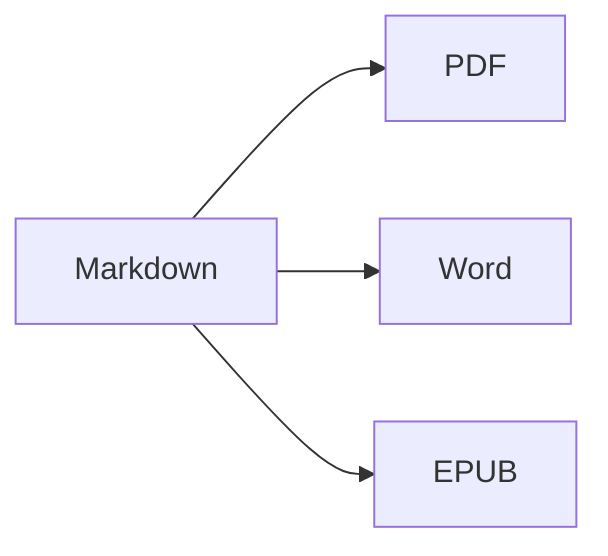

Otevřete **rozdělené zobrazení** (⌘2) a uvidíte zdrojový text i výsledek vedle sebe.

## Formátování textu

- **Tučné** – `**text**` (⌘B)
- *Kurzíva* – `*text*` (⌘I)
- ~~Přeškrtnuté~~ – `~~text~~` (⇧⌘X)
- `Kód` – `` `kód` `` (⌘`)
- [Odkaz](https://cs.wikipedia.org/wiki/Markdown) – `[text](adresa)` (⌘K)

## Nadpisy

`# Nadpis 1` … `###### Nadpis 6` (⌥⌘1 … ⌥⌘6). **Boční panel** (⌃⌘S) je zobrazuje jako osnovu.

## Seznamy

1. Číslovaný seznam (⇧⌘7)
2. Druhá položka
    - Vnořená položka (odsazení klávesou Tab)

- [x] Hotovo
- [ ] Zbývá udělat (⇧⌘9)

> Citace (⇧⌘')

## Tabulky

| Funkce | Zkratka |
|:--------|:--------:|
| Editor | ⌘1 |
| Rozdělené zobrazení | ⌘2 |
| Konečné zobrazení | ⌘3 |
| Celá obrazovka | ⌃⌘F |

V tabulce **Tab** přeskočí do další buňky a zarovná sloupce; **Return** přidá řádek.

## Kód

```swift
func greet(_ name: String) -> String {
    return "Ahoj, \(name)!"   // zvýrazněná syntaxe
}
```

## Poznámky pod čarou

Markdown podporuje poznámky pod čarou[^1].

[^1]: Text poznámky se zobrazí na konci dokumentu – a ve Wordu jako skutečná poznámka pod čarou.

## Vzorce a diagramy

V řádku: $e^{i\pi} + 1 = 0$

$$
\int_0^1 x^2\,dx = \frac{1}{3}
$$



## Obrázky

Vložte snímek obrazovky (⌘V) nebo do editoru přetáhněte obrázek: uloží se do složky `images` vedle dokumentu.

## Citace a literatura

Ve front matter uveďte soubor BibTeX (`.bib`) nebo CSL-JSON (nebo nastavte výchozí v Nastavení ▸ Psaní) a citujte pomocí `[@key]`:

```markdown
---
bibliography: references.bib
csl: vancouver        # nebo apa
---

As shown earlier [@kovacs2020, p. 5; @who2019], … @kovacs2020 found …
```

Seznam literatury se přidá na konec (nebo tam, kam umístíte `::: {#refs}` … `:::`). **Formát ▸ Citace a odkazy ▸ Vložit citaci…** (⌃⌘C) prohledává seznam literatury a přidává nové zdroje podle **DOI nebo PubMed ID**. Při psaní `@` se nabídnou klíče.

## Číslované obrázky, tabulky a křížové odkazy

| Formát | Výstup |
|--------|--------|
| PDF    | obsah s čísly stránek |
| Word   | skutečný obsah Wordu, popisky |

Table: Exporty {#tbl:exports}

@tbl:exports uvádí výstupní formáty. Obrázky označte pomocí `{#fig:name}`, rovnice pomocí `$$ … $$ {#eq:name}`, nadpisy pomocí `# Title {#sec:name}` a odkazujte na ně pomocí `@fig:name`, `@eq:name`, `@sec:name`. `[TOC]` (nebo `toc: true` ve front matter) vloží obsah; `numbersections: true` očísluje nadpisy.

## Revize: změny a komentáře

Sledované změny a komentáře z dokumentů Wordu se importují jako revizní značky – a při exportu se do Wordu vrátí jako sledované změny a komentáře: {++vloženo++}, {--smazáno--}, {~~staré~>nové~~}, {==zvýrazněno==}{>>Komentář<<}. Přijmout nebo odmítnout je můžete v nabídce **Úpravy ▸ Revize**.

## Živé formátování a nástroje pro psaní

**Zobrazení ▸ Živé formátování** (⌥⌘L) skryje značky Markdownu kromě řádku, který právě upravujete. Klepnutím na počet slov ve stavovém řádku zobrazíte statistiku, dobu čtení a cíle psaní. Karta **Hledání** v bočním panelu vyhledává a nahrazuje ve všech souborech Markdown a textových souborech složky (⌥⇧⌘F).

## Import PDF, komentáře recenzenta a porovnávání verzí

**Soubor ▸ Otevřít** (⌘O) otevře i PDF jako nový dokument Markdown: odstavce, nadpisy a seznamy se obnoví, čísla řádků, záhlaví a čísla stránek se odstraní a naskenované stránky se přečtou pomocí OCR. Komentáře a značky v PDF se změní na revizní značky. Zdroje LaTeX (`.tex`) se otevřou k úpravám beze změny.

**Soubor ▸ Importovat komentáře recenzenta z PDF…** načte komentáře z recenzovaného PDF a každý najde ve zdroji, který upravujete – v Markdownu nebo LaTeXu včetně souborů vložených příkazem `\input`. Nejprve uložte zdrojový soubor: recenze se ukládá vedle něj (`<soubor>.review.json`). Karta **Komentáře** bočního panelu (**Zobrazení ▸ Komentáře**) je zobrazí; kliknutím na komentář se vybere jeho text. Jednoduché pokyny jako `change "X" to "Y"`, `delete` nebo `add after: "Z"` se změní na návrhy, které můžete použít jednotlivě nebo tlačítkem **Použít vše** (obojí lze vrátit); ostatní můžete označit jako vyřízené, odmítnout nebo na ně odpovědět. **Vložit jako revizní značky** změní komentáře zdroje Markdown na revizní značky a **Soubor ▸ Exportovat odpověď recenzentům…** vytvoří dopis s odpovědí ve formátu Markdown nebo Word. V systému macOS 26 s Apple Intelligence navrhne **Navrhnout úpravu (AI)** úpravu přímo na vašem Macu (lze vypnout v Nastavení ▸ Psaní ▸ Recenze); bez vás se nic nepoužije.

**Soubor ▸ Porovnat dokumenty…** porovná dva soubory (Markdown, text, Word, PDF …); **Soubor ▸ Porovnat s** porovná otevřený dokument s položkou **Poslední uložená verze** (kdy jste ho naposledy sami uložili), **Starší verze…** nebo **Schránka**. Změny zobrazte **Vedle sebe** nebo **V textu**, ignorujte mezery, velikost písmen nebo formátování (formátování ovlivňuje jen porovnání na obrazovce) a mezi změnami přecházejte pomocí ⌘↑ / ⌘↓. **Otevřít s revizními značkami** změní rozdíly na změny, které můžete přijmout nebo odmítnout; **Exportovat jako Word se sledováním změn…** je uloží jako dokument Wordu.

---

**Export:** Soubor ▸ Exportovat ▸ PDF (⇧⌘E), Word (⇧⌘D), HTML nebo EPUB.
**Import:** Soubor ▸ Otevřít (⌘O) – soubory DOCX, DOC, RTF, PDF, TXT a MD.
