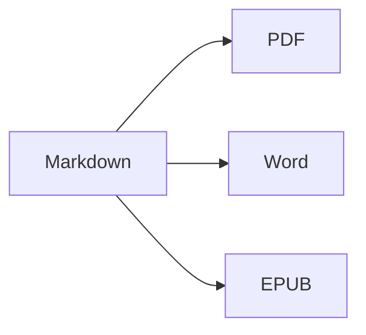

Öffne die **geteilte Ansicht** (⌘2), um Quelltext und Ergebnis nebeneinander zu sehen.

## Textformatierung

- **Fett** – `**Text**` (⌘B)
- *Kursiv* – `*Text*` (⌘I)
- ~~Durchgestrichen~~ – `~~Text~~` (⇧⌘X)
- `Code` – `` `code` `` (⌘`)
- [Link](https://de.wikipedia.org/wiki/Markdown) – `[Text](Adresse)` (⌘K)

## Überschriften

`# Überschrift 1` … `###### Überschrift 6` (⌥⌘1 … ⌥⌘6). Die **Seitenleiste** (⌃⌘S) zeigt sie als Gliederung an.

## Listen

1. Nummerierte Liste (⇧⌘7)
2. Zweiter Eintrag
    - Verschachtelter Eintrag (mit Tab einrücken)

- [x] Erledigt
- [ ] Zu erledigen (⇧⌘9)

> Zitat (⇧⌘')

## Tabellen

| Funktion | Kurzbefehl |
|:--------|:--------:|
| Editor | ⌘1 |
| Geteilte Ansicht | ⌘2 |
| Endansicht | ⌘3 |
| Vollbild | ⌃⌘F |

In einer Tabelle springt **Tab** zur nächsten Zelle und richtet die Spalten aus; **Return** fügt eine Zeile hinzu.

## Code

```swift
func greet(_ name: String) -> String {
    return "Hallo, \(name)!"   // Syntaxhervorhebung
}
```

## Fußnoten

Markdown unterstützt Fußnoten[^1].

[^1]: Der Fußnotentext erscheint am Ende des Dokuments – und in Word als echte Fußnote.

## Formeln und Diagramme

Inline: $e^{i\pi} + 1 = 0$

$$
\int_0^1 x^2\,dx = \frac{1}{3}
$$



## Bilder

Setze ein Bildschirmfoto ein (⌘V) oder ziehe ein Bild in den Editor: Es wird in einem Ordner `images` neben dem Dokument gespeichert.

---

**Export:** Ablage ▸ Exportieren ▸ PDF (⇧⌘E), Word (⇧⌘D), HTML oder EPUB.
**Import:** Ablage ▸ Öffnen (⌘O) – DOCX-, DOC-, RTF-, TXT- und MD-Dateien.
