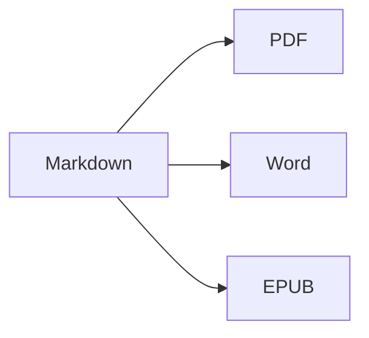

Öffne die **geteilte Ansicht** (⌘2), um Quelltext und Ergebnis nebeneinander zu sehen.

## Textformatierung

- **Fett** – `**Text**` (⌘B)
- *Kursiv* – `*Text*` (⌘I)
- ~~Durchgestrichen~~ – `~~Text~~` (⇧⌘X)
- `Code` – `` `code` `` (⌘`)
- [Link](https://de.wikipedia.org/wiki/Markdown) – `[Text](Adresse)` (⌘K)

## Überschriften

`# Überschrift 1` … `###### Überschrift 6` (⌥⌘1 … ⌥⌘6). Die **Seitenleiste** (⌃⌘S) zeigt sie als Gliederung an.

## Listen

1. Nummerierte Liste (⇧⌘7)
2. Zweiter Eintrag
    - Verschachtelter Eintrag (mit Tab einrücken)

- [x] Erledigt
- [ ] Zu erledigen (⇧⌘9)

> Zitat (⇧⌘')

## Tabellen

| Funktion | Kurzbefehl |
|:--------|:--------:|
| Editor | ⌘1 |
| Geteilte Ansicht | ⌘2 |
| Endansicht | ⌘3 |
| Vollbild | ⌃⌘F |

In einer Tabelle springt **Tab** zur nächsten Zelle und richtet die Spalten aus; **Return** fügt eine Zeile hinzu.

## Code

```swift
func greet(_ name: String) -> String {
    return "Hallo, \(name)!"   // Syntaxhervorhebung
}
```

## Fußnoten

Markdown unterstützt Fußnoten[^1].

[^1]: Der Fußnotentext erscheint am Ende des Dokuments – und in Word als echte Fußnote.

## Formeln und Diagramme

Inline: $e^{i\pi} + 1 = 0$

$$
\int_0^1 x^2\,dx = \frac{1}{3}
$$



## Bilder

Setze ein Bildschirmfoto ein (⌘V) oder ziehe ein Bild in den Editor: Es wird in einem Ordner `images` neben dem Dokument gespeichert.

## Zitate und Literatur

Gib im Front Matter eine BibTeX- (`.bib`) oder CSL-JSON-Datei an (oder lege in Einstellungen ▸ Schreiben eine Standarddatei fest) und zitiere dann mit `[@key]`:

```markdown
---
bibliography: references.bib
csl: vancouver        # oder apa
---

As shown earlier [@kovacs2020, p. 5; @who2019], … @kovacs2020 found …
```

Das Literaturverzeichnis wird am Ende eingefügt (oder dort, wo du `::: {#refs}` … `:::` platzierst). **Format ▸ Zitate & Literatur ▸ Zitat einfügen …** (⌃⌘C) durchsucht das Literaturverzeichnis und fügt neue Quellen per **DOI oder PubMed-ID** hinzu. Beim Tippen von `@` werden die Schlüssel vorgeschlagen.

## Nummerierte Abbildungen, Tabellen und Querverweise

| Format | Ergebnis |
|--------|----------|
| PDF    | Inhaltsverzeichnis mit Seitenzahlen |
| Word   | echtes Word-Inhaltsverzeichnis, Beschriftungen |

Table: Exporte {#tbl:exports}

@tbl:exports listet die Ausgabeformate auf. Kennzeichne Abbildungen mit `{#fig:name}`, Gleichungen mit `$$ … $$ {#eq:name}`, Überschriften mit `# Title {#sec:name}` und verweise auf sie mit `@fig:name`, `@eq:name`, `@sec:name`. `[TOC]` (oder `toc: true` im Front Matter) fügt ein Inhaltsverzeichnis ein; `numbersections: true` nummeriert die Überschriften.

## Überarbeitung: Änderungen und Kommentare

Nachverfolgte Änderungen und Kommentare aus Word-Dokumenten werden als Überarbeitungsmarkierungen importiert – und beim Export nach Word wieder als nachverfolgte Änderungen und Kommentare ausgegeben: {++eingefügt++}, {--gelöscht--}, {~~alt~>neu~~}, {==hervorgehoben==}{>>Ein Kommentar<<}. Unter **Bearbeiten ▸ Überarbeitung** kannst du sie annehmen oder ablehnen.

## Live-Formatierung und Schreibwerkzeuge

**Darstellung ▸ Live-Formatierung** (⌥⌘L) blendet die Markdown-Auszeichnungen aus – außer in der Zeile, die du gerade bearbeitest. Klicke in der Statusleiste auf die Wortzahl, um Statistik, Lesezeit und Schreibziele zu sehen. Der Tab **Suche** in der Seitenleiste sucht und ersetzt in allen Markdown- und Textdateien eines Ordners (⌥⇧⌘F).

---

**Export:** Ablage ▸ Exportieren ▸ PDF (⇧⌘E), Word (⇧⌘D), HTML oder EPUB.
**Import:** Ablage ▸ Öffnen (⌘O) – DOCX-, DOC-, RTF-, TXT- und MD-Dateien.
