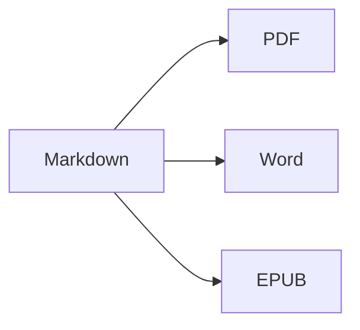

Open the **split view** (⌘2) to see the source and the result side by side.

## Text formatting

- **Bold** – `**text**` (⌘B)
- *Italic* – `*text*` (⌘I)
- ~~Strikethrough~~ – `~~text~~` (⇧⌘X)
- `Code` – `` `code` `` (⌘`)
- [Link](https://en.wikipedia.org/wiki/Markdown) – `[text](address)` (⌘K)

## Headings

`# Heading 1` … `###### Heading 6` (⌥⌘1 … ⌥⌘6). The **sidebar** (⌃⌘S) lists them as an outline.

## Lists

1. Numbered list (⇧⌘7)
2. Second item
    - Nested item (indent with Tab)

- [x] Done
- [ ] To do (⇧⌘9)

> Quote (⇧⌘')

## Tables

| Feature | Shortcut |
|:--------|:--------:|
| Editor | ⌘1 |
| Split view | ⌘2 |
| Final view | ⌘3 |
| Full screen | ⌃⌘F |

Inside a table, **Tab** jumps to the next cell and aligns the columns; **Return** adds a row.

## Code

```swift
func greet(_ name: String) -> String {
    return "Hello, \(name)!"   // syntax highlighted
}
```

## Footnotes

Markdown supports footnotes[^1].

[^1]: The footnote text appears at the end of the document — and as a real footnote in Word.

## Formulas and diagrams

Inline: $e^{i\pi} + 1 = 0$

$$
\int_0^1 x^2\,dx = \frac{1}{3}
$$



## Images

Paste a screenshot (⌘V) or drag an image into the editor: it is saved into an `images` folder next to the document.

## Citations and references

Name a BibTeX (`.bib`) or CSL-JSON file in the front matter (or set a default one in Settings ▸ Writing), then cite with `[@key]`:

```markdown
---
bibliography: references.bib
csl: vancouver        # or apa
---

As shown earlier [@kovacs2020, p. 5; @who2019], … @kovacs2020 found …
```

The reference list is added at the end (or where you put `::: {#refs}` … `:::`). **Format ▸ Citations & References ▸ Insert Citation…** (⌃⌘C) searches the bibliography and adds new references by **DOI or PubMed ID**. Typing `@` offers the keys.

## Numbered figures, tables and cross-references

| Format | Output |
|--------|--------|
| PDF    | table of contents with page numbers |
| Word   | real Word table of contents, captions |

Table: Exports {#tbl:exports}

@tbl:exports lists the outputs. Label figures with `{#fig:name}`, equations with `$$ … $$ {#eq:name}`, headings with `# Title {#sec:name}`, and refer to them with `@fig:name`, `@eq:name`, `@sec:name`. `[TOC]` (or `toc: true` in the front matter) inserts a table of contents; `numbersections: true` numbers the headings.

## Review: changes and comments

Tracked changes and comments of Word documents are imported as review marks — and exported back to Word as tracked changes and comments: {++inserted++}, {--deleted--}, {~~old~>new~~}, {==highlighted==}{>>A comment<<}. See **Edit ▸ Review** to accept or reject them.

## Live formatting and writing tools

**View ▸ Live Formatting** (⌥⌘L) hides the Markdown markup except on the line you are editing. Click the word count in the status bar for statistics, reading time and writing goals. The sidebar's **Search** tab searches and replaces in every Markdown and text file of a folder (⌥⇧⌘F).

## PDF import, review comments and comparing versions

**File ▸ Open** (⌘O) also opens a PDF as a new Markdown document: paragraphs, headings and lists are rebuilt, line numbers, running headers and page numbers are removed, and scanned pages are read with OCR. Comments and markups in the PDF become review marks. LaTeX sources (`.tex`) open for editing as they are.

**File ▸ Import Review Comments from PDF…** reads the comments of a reviewed PDF and finds each one in the source you edit – Markdown or LaTeX, including files pulled in with `\input`. Save the source file first: the review is stored next to it (`<file>.review.json`). The sidebar's **Comments** tab (**View ▸ Comments**) lists them; click one to select its text. Simple instructions such as `change "X" to "Y"`, `delete` or `add after: "Z"` become suggestions you can apply one by one or with **Apply All** (both can be undone); mark the others done, reject them or reply. **Insert as Review Marks** turns the comments of a Markdown source into review marks, and **File ▸ Export Response to Reviewers…** writes a response letter as Markdown or Word. On macOS 26 with Apple Intelligence, **Suggest Edit (AI)** proposes an edit on your Mac (can be turned off in Settings ▸ Writing ▸ Review); nothing is applied without you.

**File ▸ Compare Documents…** compares two files (Markdown, text, Word, PDF …); **File ▸ Compare With** compares the open document with its **Last Saved Version** (the last time you saved it yourself), an **Earlier Version…** or the **Clipboard**. Show the changes **Side by Side** or **Inline**, ignore whitespace, case or formatting (formatting only affects the comparison on screen), and jump between changes with ⌘↑ / ⌘↓. **Open as Review Marks** turns the differences into changes you can accept or reject; **Export as Word with Tracked Changes…** saves them as a Word document.

---

**Export:** File ▸ Export ▸ PDF (⇧⌘E), Word (⇧⌘D), HTML or EPUB.
**Import:** File ▸ Open (⌘O) – DOCX, DOC, RTF, PDF, TXT and MD files.
