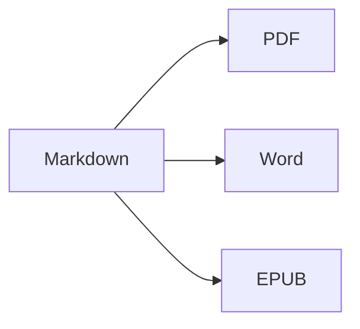

Abre la **vista dividida** (⌘2) para ver el código fuente y el resultado uno al lado del otro.

## Formato de texto

- **Negrita** – `**texto**` (⌘B)
- *Cursiva* – `*texto*` (⌘I)
- ~~Tachado~~ – `~~texto~~` (⇧⌘X)
- `Código` – `` `código` `` (⌘`)
- [Enlace](https://es.wikipedia.org/wiki/Markdown) – `[texto](dirección)` (⌘K)

## Encabezados

`# Encabezado 1` … `###### Encabezado 6` (⌥⌘1 … ⌥⌘6). La **barra lateral** (⌃⌘S) los muestra como un esquema.

## Listas

1. Lista numerada (⇧⌘7)
2. Segundo elemento
    - Elemento anidado (sangría con Tab)

- [x] Hecho
- [ ] Pendiente (⇧⌘9)

> Cita (⇧⌘')

## Tablas

| Función | Atajo |
|:--------|:--------:|
| Editor | ⌘1 |
| Vista dividida | ⌘2 |
| Vista final | ⌘3 |
| Pantalla completa | ⌃⌘F |

Dentro de una tabla, **Tab** salta a la celda siguiente y alinea las columnas; **Retorno** añade una fila.

## Código

```swift
func greet(_ name: String) -> String {
    return "¡Hola, \(name)!"   // resaltado de sintaxis
}
```

## Notas al pie

Markdown admite notas al pie[^1].

[^1]: El texto de la nota aparece al final del documento, y como una nota al pie real en Word.

## Fórmulas y diagramas

En línea: $e^{i\pi} + 1 = 0$

$$
\int_0^1 x^2\,dx = \frac{1}{3}
$$



## Imágenes

Pega una captura de pantalla (⌘V) o arrastra una imagen al editor: se guarda en una carpeta `images` junto al documento.

---

**Exportar:** Archivo ▸ Exportar ▸ PDF (⇧⌘E), Word (⇧⌘D), HTML o EPUB.
**Importar:** Archivo ▸ Abrir (⌘O) – archivos DOCX, DOC, RTF, TXT y MD.
