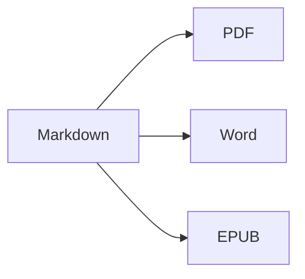

Abre la **vista dividida** (⌘2) para ver el código fuente y el resultado uno al lado del otro.

## Formato de texto

- **Negrita** – `**texto**` (⌘B)
- *Cursiva* – `*texto*` (⌘I)
- ~~Tachado~~ – `~~texto~~` (⇧⌘X)
- `Código` – `` `código` `` (⌘`)
- [Enlace](https://es.wikipedia.org/wiki/Markdown) – `[texto](dirección)` (⌘K)

## Encabezados

`# Encabezado 1` … `###### Encabezado 6` (⌥⌘1 … ⌥⌘6). La **barra lateral** (⌃⌘S) los muestra como un esquema.

## Listas

1. Lista numerada (⇧⌘7)
2. Segundo elemento
    - Elemento anidado (sangría con Tab)

- [x] Hecho
- [ ] Pendiente (⇧⌘9)

> Cita (⇧⌘')

## Tablas

| Función | Atajo |
|:--------|:--------:|
| Editor | ⌘1 |
| Vista dividida | ⌘2 |
| Vista final | ⌘3 |
| Pantalla completa | ⌃⌘F |

Dentro de una tabla, **Tab** salta a la celda siguiente y alinea las columnas; **Retorno** añade una fila.

## Código

```swift
func greet(_ name: String) -> String {
    return "¡Hola, \(name)!"   // resaltado de sintaxis
}
```

## Notas al pie

Markdown admite notas al pie[^1].

[^1]: El texto de la nota aparece al final del documento, y como una nota al pie real en Word.

## Fórmulas y diagramas

En línea: $e^{i\pi} + 1 = 0$

$$
\int_0^1 x^2\,dx = \frac{1}{3}
$$



## Imágenes

Pega una captura de pantalla (⌘V) o arrastra una imagen al editor: se guarda en una carpeta `images` junto al documento.

## Citas y referencias

Indica un archivo BibTeX (`.bib`) o CSL-JSON en el front matter (o establece uno por omisión en Ajustes ▸ Escritura) y cita con `[@key]`:

```markdown
---
bibliography: references.bib
csl: vancouver        # o apa
---

As shown earlier [@kovacs2020, p. 5; @who2019], … @kovacs2020 found …
```

La lista de referencias se añade al final (o donde pongas `::: {#refs}` … `:::`). **Formato ▸ Citas y referencias ▸ Insertar cita…** (⌃⌘C) busca en la bibliografía y añade nuevas referencias por **DOI o ID de PubMed**. Al escribir `@` se sugieren las claves.

## Figuras, tablas numeradas y referencias cruzadas

| Formato | Resultado |
|---------|-----------|
| PDF     | índice con números de página |
| Word    | índice real de Word, pies de figura y tabla |

Table: Exportaciones {#tbl:exports}

@tbl:exports enumera los formatos de salida. Etiqueta las figuras con `{#fig:name}`, las ecuaciones con `$$ … $$ {#eq:name}`, los encabezados con `# Title {#sec:name}` y haz referencia a ellos con `@fig:name`, `@eq:name`, `@sec:name`. `[TOC]` (o `toc: true` en el front matter) inserta un índice; `numbersections: true` numera los encabezados.

## Revisión: cambios y comentarios

Los cambios controlados y los comentarios de los documentos de Word se importan como marcas de revisión, y se vuelven a exportar a Word como cambios controlados y comentarios: {++insertado++}, {--eliminado--}, {~~antiguo~>nuevo~~}, {==resaltado==}{>>Un comentario<<}. Usa **Edición ▸ Revisión** para aceptarlos o rechazarlos.

## Formato en vivo y herramientas de escritura

**Visualización ▸ Formato en vivo** (⌥⌘L) oculta las marcas de Markdown excepto en la línea que estás editando. Haz clic en el recuento de palabras de la barra de estado para ver estadísticas, tiempo de lectura y objetivos de escritura. La pestaña **Buscar** de la barra lateral busca y reemplaza en todos los archivos Markdown y de texto de una carpeta (⌥⇧⌘F).

---

**Exportar:** Archivo ▸ Exportar ▸ PDF (⇧⌘E), Word (⇧⌘D), HTML o EPUB.
**Importar:** Archivo ▸ Abrir (⌘O) – archivos DOCX, DOC, RTF, TXT y MD.
