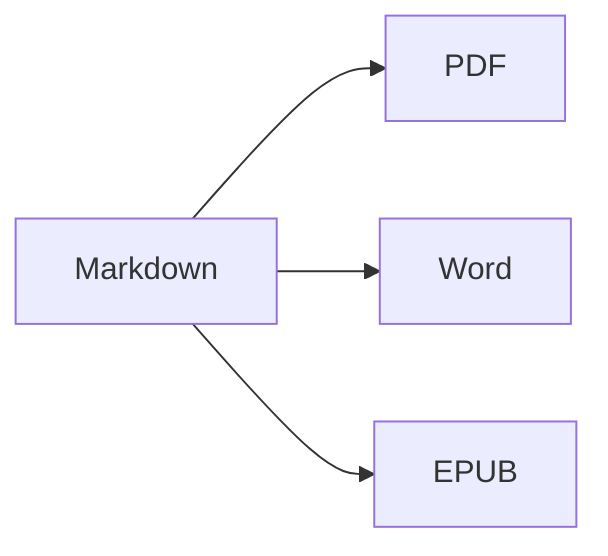

Ouvrez la **vue partagée** (⌘2) pour voir la source et le résultat côte à côte.

## Mise en forme du texte

- **Gras** – `**texte**` (⌘B)
- *Italique* – `*texte*` (⌘I)
- ~~Barré~~ – `~~texte~~` (⇧⌘X)
- `Code` – `` `code` `` (⌘`)
- [Lien](https://fr.wikipedia.org/wiki/Markdown) – `[texte](adresse)` (⌘K)

## Titres

`# Titre 1` … `###### Titre 6` (⌥⌘1 … ⌥⌘6). La **barre latérale** (⌃⌘S) les affiche sous forme de plan.

## Listes

1. Liste numérotée (⇧⌘7)
2. Deuxième élément
    - Élément imbriqué (indenter avec Tab)

- [x] Fait
- [ ] À faire (⇧⌘9)

> Citation (⇧⌘')

## Tableaux

| Fonction | Raccourci |
|:--------|:--------:|
| Éditeur | ⌘1 |
| Vue partagée | ⌘2 |
| Vue finale | ⌘3 |
| Plein écran | ⌃⌘F |

Dans un tableau, **Tab** passe à la cellule suivante et aligne les colonnes ; **Retour** ajoute une ligne.

## Code

```swift
func greet(_ name: String) -> String {
    return "Bonjour, \(name) !"   // coloration syntaxique
}
```

## Notes de bas de page

Markdown prend en charge les notes de bas de page[^1].

[^1]: Le texte de la note apparaît à la fin du document — et comme une véritable note de bas de page dans Word.

## Formules et diagrammes

En ligne : $e^{i\pi} + 1 = 0$

$$
\int_0^1 x^2\,dx = \frac{1}{3}
$$



## Images

Collez une capture d’écran (⌘V) ou faites glisser une image dans l’éditeur : elle est enregistrée dans un dossier `images` à côté du document.

## Citations et références

Indiquez un fichier BibTeX (`.bib`) ou CSL-JSON dans le front matter (ou définissez-en un par défaut dans Réglages ▸ Écriture), puis citez avec `[@key]` :

```markdown
---
bibliography: references.bib
csl: vancouver        # ou apa
---

As shown earlier [@kovacs2020, p. 5; @who2019], … @kovacs2020 found …
```

La bibliographie est ajoutée à la fin (ou à l’endroit où vous placez `::: {#refs}` … `:::`). **Format ▸ Citations et références ▸ Insérer une citation…** (⌃⌘C) recherche dans la bibliographie et ajoute de nouvelles références par **DOI ou identifiant PubMed**. La saisie de `@` propose les clés.

## Figures, tableaux numérotés et renvois

| Format | Résultat |
|--------|----------|
| PDF    | table des matières avec numéros de page |
| Word   | véritable table des matières Word, légendes |

Table: Exportations {#tbl:exports}

@tbl:exports liste les formats de sortie. Étiquetez les figures avec `{#fig:name}`, les équations avec `$$ … $$ {#eq:name}`, les titres avec `# Title {#sec:name}`, et faites-y référence avec `@fig:name`, `@eq:name`, `@sec:name`. `[TOC]` (ou `toc: true` dans le front matter) insère une table des matières ; `numbersections: true` numérote les titres.

## Révision : modifications et commentaires

Les modifications suivies et les commentaires des documents Word sont importés comme marques de révision – et réexportés vers Word comme modifications suivies et commentaires : {++inséré++}, {--supprimé--}, {~~ancien~>nouveau~~}, {==surligné==}{>>Un commentaire<<}. Utilisez **Édition ▸ Révision** pour les accepter ou les refuser.

## Mise en forme en direct et outils d’écriture

**Présentation ▸ Mise en forme en direct** (⌥⌘L) masque le balisage Markdown, sauf sur la ligne en cours de modification. Cliquez sur le nombre de mots dans la barre d’état pour afficher les statistiques, le temps de lecture et les objectifs d’écriture. L’onglet **Recherche** de la barre latérale recherche et remplace dans tous les fichiers Markdown et texte d’un dossier (⌥⇧⌘F).

---

**Exporter :** Fichier ▸ Exporter ▸ PDF (⇧⌘E), Word (⇧⌘D), HTML ou EPUB.
**Importer :** Fichier ▸ Ouvrir (⌘O) – fichiers DOCX, DOC, RTF, TXT et MD.
