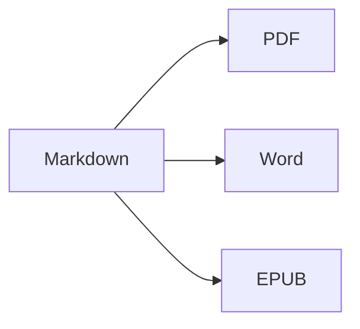

Ouvrez la **vue partagée** (⌘2) pour voir la source et le résultat côte à côte.

## Mise en forme du texte

- **Gras** – `**texte**` (⌘B)
- *Italique* – `*texte*` (⌘I)
- ~~Barré~~ – `~~texte~~` (⇧⌘X)
- `Code` – `` `code` `` (⌘`)
- [Lien](https://fr.wikipedia.org/wiki/Markdown) – `[texte](adresse)` (⌘K)

## Titres

`# Titre 1` … `###### Titre 6` (⌥⌘1 … ⌥⌘6). La **barre latérale** (⌃⌘S) les affiche sous forme de plan.

## Listes

1. Liste numérotée (⇧⌘7)
2. Deuxième élément
    - Élément imbriqué (indenter avec Tab)

- [x] Fait
- [ ] À faire (⇧⌘9)

> Citation (⇧⌘')

## Tableaux

| Fonction | Raccourci |
|:--------|:--------:|
| Éditeur | ⌘1 |
| Vue partagée | ⌘2 |
| Vue finale | ⌘3 |
| Plein écran | ⌃⌘F |

Dans un tableau, **Tab** passe à la cellule suivante et aligne les colonnes ; **Retour** ajoute une ligne.

## Code

```swift
func greet(_ name: String) -> String {
    return "Bonjour, \(name) !"   // coloration syntaxique
}
```

## Notes de bas de page

Markdown prend en charge les notes de bas de page[^1].

[^1]: Le texte de la note apparaît à la fin du document — et comme une véritable note de bas de page dans Word.

## Formules et diagrammes

En ligne : $e^{i\pi} + 1 = 0$

$$
\int_0^1 x^2\,dx = \frac{1}{3}
$$



## Images

Collez une capture d’écran (⌘V) ou faites glisser une image dans l’éditeur : elle est enregistrée dans un dossier `images` à côté du document.

---

**Exporter :** Fichier ▸ Exporter ▸ PDF (⇧⌘E), Word (⇧⌘D), HTML ou EPUB.
**Importer :** Fichier ▸ Ouvrir (⌘O) – fichiers DOCX, DOC, RTF, TXT et MD.
