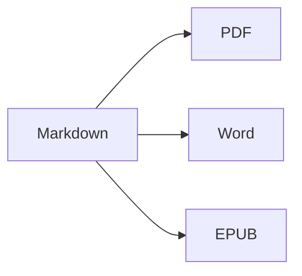

Nyissa meg az **osztott nézetet** (⌘2), hogy egymás mellett lássa a forrásszöveget és az eredményt.

## Szövegformázás

- **Félkövér** – `**szöveg**` (⌘B)
- *Dőlt* – `*szöveg*` (⌘I)
- ~~Áthúzott~~ – `~~szöveg~~` (⇧⌘X)
- `Kód` – `` `kód` `` (⌘`)
- [Hivatkozás](https://hu.wikipedia.org/wiki/Markdown) – `[szöveg](cím)` (⌘K)

## Címsorok

`# 1. címsor` … `###### 6. címsor` (⌥⌘1 … ⌥⌘6). Az **oldalsáv** (⌃⌘S) vázlatként listázza őket.

## Listák

1. Számozott lista (⇧⌘7)
2. Második elem
    - Beágyazott elem (behúzás Tab billentyűvel)

- [x] Kész
- [ ] Teendő (⇧⌘9)

> Idézet (⇧⌘')

## Táblázatok

| Funkció | Billentyűparancs |
|:--------|:--------:|
| Szerkesztő | ⌘1 |
| Osztott nézet | ⌘2 |
| Végleges nézet | ⌘3 |
| Teljes képernyő | ⌃⌘F |

Táblázaton belül a **Tab** a következő cellára ugrik, és igazítja az oszlopokat; a **Return** új sort ad hozzá.

## Kód

```swift
func greet(_ name: String) -> String {
    return "Szia, \(name)!"   // szintaxiskiemeléssel
}
```

## Lábjegyzetek

A Markdown támogatja a lábjegyzeteket[^1].

[^1]: A lábjegyzet szövege a dokumentum végén jelenik meg – Wordben pedig valódi lábjegyzetként.

## Képletek és diagramok

Szövegközi: $e^{i\pi} + 1 = 0$

$$
\int_0^1 x^2\,dx = \frac{1}{3}
$$



## Képek

Illesszen be egy képernyőképet (⌘V), vagy húzzon egy képet a szerkesztőbe: a kép a dokumentum melletti `images` mappába kerül.

## Hivatkozások és irodalomjegyzék

Adj meg egy BibTeX (`.bib`) vagy CSL-JSON fájlt a front matterben (vagy alapértelmezettként a Beállítások ▸ Írás lapon), majd hivatkozz így: `[@kulcs]`:

```markdown
---
bibliography: references.bib
csl: vancouver        # vagy apa
---

Ahogy korábban láttuk [@kovacs2020, p. 5; @who2019], … @kovacs2020 szerint …
```

Az irodalomjegyzék a dokumentum végére kerül (vagy oda, ahová a `::: {#refs}` … `:::` jelölést teszed). A **Formátum ▸ Hivatkozások ▸ Hivatkozás beszúrása…** (⌃⌘C) keres az irodalomjegyzékben, és **DOI vagy PubMed-azonosító** alapján új tételt is hozzáad. A `@` begépelésekor az app felajánlja a kulcsokat.

## Számozott ábrák, táblázatok és kereszthivatkozások

| Formátum | Eredmény |
|----------|----------|
| PDF      | tartalomjegyzék oldalszámokkal |
| Word     | valódi Word-tartalomjegyzék, feliratok |

Table: Exportok {#tbl:exports}

A @tbl:exports a kimeneteket sorolja fel. Ábra: `{#fig:nev}`, egyenlet: `$$ … $$ {#eq:nev}`, címsor: `# Cím {#sec:nev}`; hivatkozás rájuk: `@fig:nev`, `@eq:nev`, `@sec:nev`. A `[TOC]` (vagy a front matterben `toc: true`) tartalomjegyzéket szúr be, a `numbersections: true` beszámozza a címsorokat.

## Véleményezés: változások és megjegyzések

A Word-dokumentumok követett változásai és megjegyzései jelölésként kerülnek be – és Word-exportnál újra követett változásként és megjegyzésként jelennek meg: {++beszúrt++}, {--törölt--}, {~~régi~>új~~}, {==kiemelt==}{>>Egy megjegyzés<<}. Elfogadásukhoz vagy elvetésükhöz lásd: **Szerkesztés ▸ Véleményezés**.

## Élő formázás és írássegítők

A **Nézet ▸ Élő formázás** (⌥⌘L) elrejti a Markdown-jelölést, kivéve a szerkesztett sort. Az állapotsor szószámára kattintva statisztikát, olvasási időt és írási célokat látsz. Az oldalsáv **Keresés** lapja egy mappa összes Markdown- és szövegfájljában keres és cserél (⌥⇧⌘F).

---

**Exportálás:** Fájl ▸ Exportálás ▸ PDF (⇧⌘E), Word (⇧⌘D), HTML vagy EPUB.
**Importálás:** Fájl ▸ Megnyitás (⌘O) – DOCX, DOC, RTF, TXT és MD fájlok.
