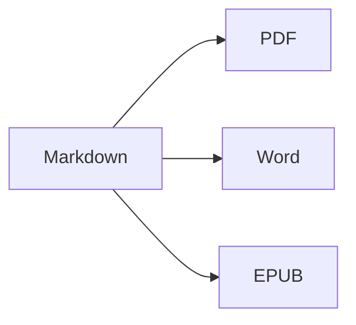

Apri la **vista divisa** (⌘2) per vedere il sorgente e il risultato fianco a fianco.

## Formattazione del testo

- **Grassetto** – `**testo**` (⌘B)
- *Corsivo* – `*testo*` (⌘I)
- ~~Barrato~~ – `~~testo~~` (⇧⌘X)
- `Codice` – `` `codice` `` (⌘`)
- [Link](https://it.wikipedia.org/wiki/Markdown) – `[testo](indirizzo)` (⌘K)

## Titoli

`# Titolo 1` … `###### Titolo 6` (⌥⌘1 … ⌥⌘6). La **barra laterale** (⌃⌘S) li elenca come struttura.

## Elenchi

1. Elenco numerato (⇧⌘7)
2. Secondo elemento
    - Elemento nidificato (rientro con Tab)

- [x] Fatto
- [ ] Da fare (⇧⌘9)

> Citazione (⇧⌘')

## Tabelle

| Funzione | Abbreviazione |
|:--------|:--------:|
| Editor | ⌘1 |
| Vista divisa | ⌘2 |
| Vista finale | ⌘3 |
| Tutto schermo | ⌃⌘F |

All'interno di una tabella, **Tab** passa alla cella successiva e allinea le colonne; **A capo** aggiunge una riga.

## Codice

```swift
func greet(_ name: String) -> String {
    return "Ciao, \(name)!"   // evidenziazione della sintassi
}
```

## Note a piè di pagina

Markdown supporta le note a piè di pagina[^1].

[^1]: Il testo della nota appare alla fine del documento — e come vera nota a piè di pagina in Word.

## Formule e diagrammi

In linea: $e^{i\pi} + 1 = 0$

$$
\int_0^1 x^2\,dx = \frac{1}{3}
$$



## Immagini

Incolla un'istantanea dello schermo (⌘V) o trascina un'immagine nell'editor: verrà salvata in una cartella `images` accanto al documento.

## Citazioni e bibliografia

Indica un file BibTeX (`.bib`) o CSL-JSON nel front matter (oppure impostane uno predefinito in Impostazioni ▸ Scrittura), quindi cita con `[@key]`:

```markdown
---
bibliography: references.bib
csl: vancouver        # oppure apa
---

As shown earlier [@kovacs2020, p. 5; @who2019], … @kovacs2020 found …
```

La bibliografia viene aggiunta alla fine (o dove inserisci `::: {#refs}` … `:::`). **Formato ▸ Citazioni e bibliografia ▸ Inserisci citazione…** (⌃⌘C) cerca nella bibliografia e aggiunge nuovi riferimenti tramite **DOI o ID PubMed**. Digitando `@` vengono proposte le chiavi.

## Figure, tabelle numerate e riferimenti incrociati

| Formato | Risultato |
|---------|-----------|
| PDF     | indice con numeri di pagina |
| Word    | vero indice di Word, didascalie |

Table: Esportazioni {#tbl:exports}

@tbl:exports elenca i formati di uscita. Etichetta le figure con `{#fig:name}`, le equazioni con `$$ … $$ {#eq:name}`, le intestazioni con `# Title {#sec:name}` e fai riferimento a esse con `@fig:name`, `@eq:name`, `@sec:name`. `[TOC]` (o `toc: true` nel front matter) inserisce un indice; `numbersections: true` numera le intestazioni.

## Revisione: modifiche e commenti

Le revisioni e i commenti dei documenti Word vengono importati come segni di revisione e riesportati in Word come revisioni e commenti: {++inserito++}, {--eliminato--}, {~~vecchio~>nuovo~~}, {==evidenziato==}{>>Un commento<<}. Usa **Composizione ▸ Revisione** per accettarli o rifiutarli.

## Formattazione dal vivo e strumenti di scrittura

**Vista ▸ Formattazione dal vivo** (⌥⌘L) nasconde i marcatori Markdown tranne che nella riga che stai modificando. Fai clic sul conteggio delle parole nella barra di stato per statistiche, tempo di lettura e obiettivi di scrittura. Il pannello **Cerca** della barra laterale cerca e sostituisce in tutti i file Markdown e di testo di una cartella (⌥⇧⌘F).

## Importazione PDF, commenti di revisione e confronto delle versioni

**Archivio ▸ Apri** (⌘O) apre anche un PDF come nuovo documento Markdown: paragrafi, intestazioni ed elenchi vengono ricostruiti, numeri di riga, intestazioni di pagina e numeri di pagina vengono rimossi e le pagine scansionate vengono lette con l'OCR. I commenti e le annotazioni del PDF diventano segni di revisione. I sorgenti LaTeX (`.tex`) si aprono così come sono, pronti per la modifica.

**Archivio ▸ Importa commenti di revisione da PDF…** legge i commenti di un PDF revisionato e trova ciascuno nel sorgente che stai modificando: Markdown o LaTeX, compresi i file richiamati con `\input`. Salva prima il file sorgente: la revisione viene archiviata accanto a esso (`<file>.review.json`). Il pannello **Commenti** della barra laterale (**Vista ▸ Commenti**) li elenca; fai clic su uno per selezionarne il testo. Le istruzioni semplici come `change "X" to "Y"`, `delete` o `add after: "Z"` diventano suggerimenti che puoi applicare uno alla volta o con **Applica tutti** (entrambe le operazioni si possono annullare); gli altri puoi segnarli come fatti, rifiutarli o rispondere. **Inserisci come segni di revisione** trasforma i commenti di un sorgente Markdown in segni di revisione e **Archivio ▸ Esporta risposta ai revisori…** scrive una lettera di risposta in Markdown o Word. Su macOS 26 con Apple Intelligence, **Suggerisci modifica (IA)** propone una modifica direttamente sul tuo Mac (attivala in Impostazioni ▸ Scrittura); nulla viene applicato senza di te.

**Archivio ▸ Confronta documenti…** confronta due file (Markdown, testo, Word, PDF…); **Archivio ▸ Confronta con** confronta il documento aperto con la sua **Ultima versione salvata** (l'ultima volta che l'hai salvato tu), una **Versione precedente…** o gli **Appunti**. Mostra le modifiche **Affiancati** o **In linea**, ignora spazi, maiuscole/minuscole o formattazione (la formattazione influisce solo sul confronto a schermo) e passa da una modifica all'altra con ⌘↑ / ⌘↓. **Apri come segni di revisione** trasforma le differenze in modifiche da accettare o rifiutare; **Esporta come Word con revisioni…** le salva come documento Word.

---

**Esportazione:** Archivio ▸ Esporta ▸ PDF (⇧⌘E), Word (⇧⌘D), HTML o EPUB.
**Importazione:** Archivio ▸ Apri (⌘O) – file DOCX, DOC, RTF, PDF, TXT e MD.
