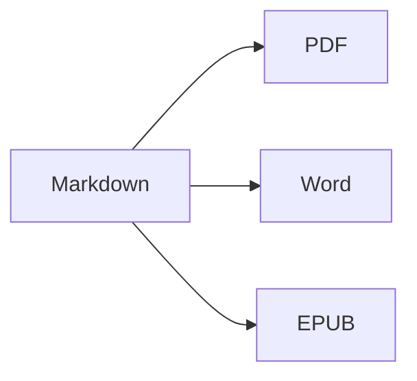

Apri la **vista divisa** (⌘2) per vedere il sorgente e il risultato fianco a fianco.

## Formattazione del testo

- **Grassetto** – `**testo**` (⌘B)
- *Corsivo* – `*testo*` (⌘I)
- ~~Barrato~~ – `~~testo~~` (⇧⌘X)
- `Codice` – `` `codice` `` (⌘`)
- [Link](https://it.wikipedia.org/wiki/Markdown) – `[testo](indirizzo)` (⌘K)

## Titoli

`# Titolo 1` … `###### Titolo 6` (⌥⌘1 … ⌥⌘6). La **barra laterale** (⌃⌘S) li elenca come struttura.

## Elenchi

1. Elenco numerato (⇧⌘7)
2. Secondo elemento
    - Elemento nidificato (rientro con Tab)

- [x] Fatto
- [ ] Da fare (⇧⌘9)

> Citazione (⇧⌘')

## Tabelle

| Funzione | Abbreviazione |
|:--------|:--------:|
| Editor | ⌘1 |
| Vista divisa | ⌘2 |
| Vista finale | ⌘3 |
| Tutto schermo | ⌃⌘F |

All'interno di una tabella, **Tab** passa alla cella successiva e allinea le colonne; **A capo** aggiunge una riga.

## Codice

```swift
func greet(_ name: String) -> String {
    return "Ciao, \(name)!"   // evidenziazione della sintassi
}
```

## Note a piè di pagina

Markdown supporta le note a piè di pagina[^1].

[^1]: Il testo della nota appare alla fine del documento — e come vera nota a piè di pagina in Word.

## Formule e diagrammi

In linea: $e^{i\pi} + 1 = 0$

$$
\int_0^1 x^2\,dx = \frac{1}{3}
$$



## Immagini

Incolla un'istantanea dello schermo (⌘V) o trascina un'immagine nell'editor: verrà salvata in una cartella `images` accanto al documento.

---

**Esportazione:** Archivio ▸ Esporta ▸ PDF (⇧⌘E), Word (⇧⌘D), HTML o EPUB.
**Importazione:** Archivio ▸ Apri (⌘O) – file DOCX, DOC, RTF, TXT e MD.
