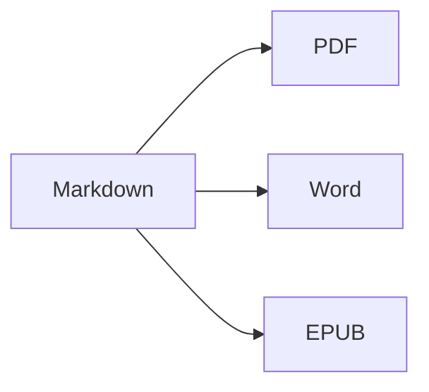

Abra a **visualização dividida** (⌘2) para ver o código-fonte e o resultado lado a lado.

## Formatação de texto

- **Negrito** – `**texto**` (⌘B)
- *Itálico* – `*texto*` (⌘I)
- ~~Tachado~~ – `~~texto~~` (⇧⌘X)
- `Código` – `` `código` `` (⌘`)
- [Link](https://pt.wikipedia.org/wiki/Markdown) – `[texto](endereço)` (⌘K)

## Títulos

`# Título 1` … `###### Título 6` (⌥⌘1 … ⌥⌘6). A **barra lateral** (⌃⌘S) os exibe como uma estrutura.

## Listas

1. Lista numerada (⇧⌘7)
2. Segundo item
    - Item aninhado (recue com Tab)

- [x] Concluído
- [ ] A fazer (⇧⌘9)

> Citação (⇧⌘')

## Tabelas

| Recurso | Atalho |
|:--------|:--------:|
| Editor | ⌘1 |
| Visualização dividida | ⌘2 |
| Visualização final | ⌘3 |
| Tela cheia | ⌃⌘F |

Dentro de uma tabela, **Tab** pula para a próxima célula e alinha as colunas; **Return** adiciona uma linha.

## Código

```swift
func greet(_ name: String) -> String {
    return "Olá, \(name)!"   // realce de sintaxe
}
```

## Notas de rodapé

O Markdown suporta notas de rodapé[^1].

[^1]: O texto da nota aparece no final do documento — e como uma nota de rodapé real no Word.

## Fórmulas e diagramas

Em linha: $e^{i\pi} + 1 = 0$

$$
\int_0^1 x^2\,dx = \frac{1}{3}
$$



## Imagens

Cole uma captura de tela (⌘V) ou arraste uma imagem para o editor: ela é salva em uma pasta `images` ao lado do documento.

## Citações e referências

Indique um arquivo BibTeX (`.bib`) ou CSL-JSON no front matter (ou defina um padrão em Ajustes ▸ Escrita) e cite com `[@key]`:

```markdown
---
bibliography: references.bib
csl: vancouver        # ou apa
---

As shown earlier [@kovacs2020, p. 5; @who2019], … @kovacs2020 found …
```

A lista de referências é adicionada no final (ou onde você colocar `::: {#refs}` … `:::`). **Formatar ▸ Citações e Referências ▸ Inserir Citação…** (⌃⌘C) busca na bibliografia e adiciona novas referências por **DOI ou ID do PubMed**. Ao digitar `@`, as chaves são sugeridas.

## Figuras, tabelas numeradas e referências cruzadas

| Formato | Resultado |
|---------|-----------|
| PDF     | sumário com números de página |
| Word    | sumário real do Word, legendas |

Table: Exportações {#tbl:exports}

@tbl:exports lista os formatos de saída. Rotule figuras com `{#fig:name}`, equações com `$$ … $$ {#eq:name}`, cabeçalhos com `# Title {#sec:name}` e faça referência a eles com `@fig:name`, `@eq:name`, `@sec:name`. `[TOC]` (ou `toc: true` no front matter) insere um sumário; `numbersections: true` numera os cabeçalhos.

## Revisão: alterações e comentários

As alterações controladas e os comentários de documentos do Word são importados como marcas de revisão — e exportados de volta para o Word como alterações controladas e comentários: {++inserido++}, {--apagado--}, {~~antigo~>novo~~}, {==destacado==}{>>Um comentário<<}. Use **Editar ▸ Revisão** para aceitá-los ou rejeitá-los.

## Formatação ao vivo e ferramentas de escrita

**Visualizar ▸ Formatação ao Vivo** (⌥⌘L) oculta as marcações Markdown, exceto na linha que você está editando. Clique na contagem de palavras na barra de status para ver estatísticas, tempo de leitura e metas de escrita. A aba **Buscar** da barra lateral busca e substitui em todos os arquivos Markdown e de texto de uma pasta (⌥⇧⌘F).

## Importação de PDF, comentários de revisão e comparação de versões

**Arquivo ▸ Abrir** (⌘O) também abre um PDF como um novo documento Markdown: parágrafos, cabeçalhos e listas são reconstruídos, números de linha, cabeçalhos de página e números de página são removidos, e páginas digitalizadas são lidas com OCR. Comentários e marcações do PDF tornam-se marcas de revisão. Fontes LaTeX (`.tex`) abrem para edição como estão.

**Arquivo ▸ Importar Comentários de Revisão do PDF…** lê os comentários de um PDF revisado e localiza cada um na fonte que você edita – Markdown ou LaTeX, inclusive os arquivos inseridos com `\input`. Salve primeiro o arquivo de origem: a revisão é armazenada ao lado dele (`<arquivo>.review.json`). A aba **Comentários** da barra lateral (**Visualizar ▸ Comentários**) os lista; clique em um para selecionar o texto correspondente. Instruções simples como `change "X" to "Y"`, `delete` ou `add after: "Z"` tornam-se sugestões que você pode aplicar uma a uma ou com **Aplicar Todas** (ambas podem ser desfeitas); os demais você pode marcar como concluídos, rejeitar ou responder. **Inserir como Marcas de Revisão** transforma os comentários de uma fonte Markdown em marcas de revisão, e **Arquivo ▸ Exportar Resposta aos Revisores…** escreve uma carta de resposta em Markdown ou Word. No macOS 26 com Apple Intelligence, **Sugerir Edição (IA)** propõe uma edição no próprio Mac (ative em Ajustes ▸ Escrita); nada é aplicado sem você.

**Arquivo ▸ Comparar Documentos…** compara dois arquivos (Markdown, texto, Word, PDF…); **Arquivo ▸ Comparar Com** compara o documento aberto com a **Última Versão Salva** (a última vez que você mesmo o salvou), uma **Versão Anterior…** ou a **Área de Transferência**. Mostre as alterações **Lado a Lado** ou **Em Linha**, ignore espaços em branco, maiúsculas e minúsculas ou formatação (a formatação afeta apenas a comparação na tela) e salte entre as alterações com ⌘↑ / ⌘↓. **Abrir como Marcas de Revisão** transforma as diferenças em alterações que você pode aceitar ou rejeitar; **Exportar como Word com Controle de Alterações…** as salva como documento do Word.

---

**Exportar:** Arquivo ▸ Exportar ▸ PDF (⇧⌘E), Word (⇧⌘D), HTML ou EPUB.
**Importar:** Arquivo ▸ Abrir (⌘O) – arquivos DOCX, DOC, RTF, PDF, TXT e MD.
