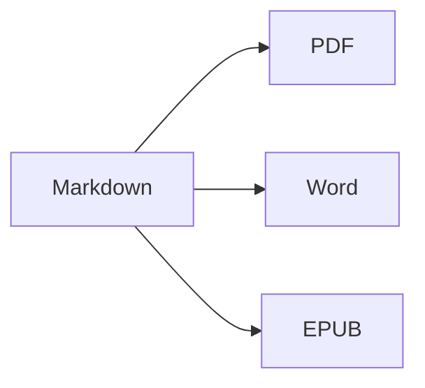

Abra a **visualização dividida** (⌘2) para ver o código-fonte e o resultado lado a lado.

## Formatação de texto

- **Negrito** – `**texto**` (⌘B)
- *Itálico* – `*texto*` (⌘I)
- ~~Tachado~~ – `~~texto~~` (⇧⌘X)
- `Código` – `` `código` `` (⌘`)
- [Link](https://pt.wikipedia.org/wiki/Markdown) – `[texto](endereço)` (⌘K)

## Títulos

`# Título 1` … `###### Título 6` (⌥⌘1 … ⌥⌘6). A **barra lateral** (⌃⌘S) os exibe como uma estrutura.

## Listas

1. Lista numerada (⇧⌘7)
2. Segundo item
    - Item aninhado (recue com Tab)

- [x] Concluído
- [ ] A fazer (⇧⌘9)

> Citação (⇧⌘')

## Tabelas

| Recurso | Atalho |
|:--------|:--------:|
| Editor | ⌘1 |
| Visualização dividida | ⌘2 |
| Visualização final | ⌘3 |
| Tela cheia | ⌃⌘F |

Dentro de uma tabela, **Tab** pula para a próxima célula e alinha as colunas; **Return** adiciona uma linha.

## Código

```swift
func greet(_ name: String) -> String {
    return "Olá, \(name)!"   // realce de sintaxe
}
```

## Notas de rodapé

O Markdown suporta notas de rodapé[^1].

[^1]: O texto da nota aparece no final do documento — e como uma nota de rodapé real no Word.

## Fórmulas e diagramas

Em linha: $e^{i\pi} + 1 = 0$

$$
\int_0^1 x^2\,dx = \frac{1}{3}
$$



## Imagens

Cole uma captura de tela (⌘V) ou arraste uma imagem para o editor: ela é salva em uma pasta `images` ao lado do documento.

---

**Exportar:** Arquivo ▸ Exportar ▸ PDF (⇧⌘E), Word (⇧⌘D), HTML ou EPUB.
**Importar:** Arquivo ▸ Abrir (⌘O) – arquivos DOCX, DOC, RTF, TXT e MD.
