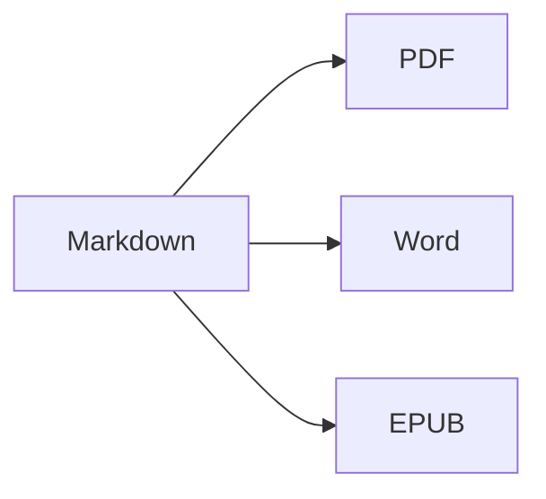

Deschideți **vizualizarea divizată** (⌘2) pentru a vedea sursa și rezultatul unul lângă altul.

## Formatarea textului

- **Aldin** – `**text**` (⌘B)
- *Cursiv* – `*text*` (⌘I)
- ~~Tăiat~~ – `~~text~~` (⇧⌘X)
- `Cod` – `` `cod` `` (⌘`)
- [Link](https://ro.wikipedia.org/wiki/Markdown) – `[text](adresă)` (⌘K)

## Titluri

`# Titlu 1` … `###### Titlu 6` (⌥⌘1 … ⌥⌘6). **Bara laterală** (⌃⌘S) le afișează ca structură.

## Liste

1. Listă numerotată (⇧⌘7)
2. Al doilea element
    - Element imbricat (indentare cu Tab)

- [x] Gata
- [ ] De făcut (⇧⌘9)

> Citat (⇧⌘')

## Tabele

| Funcție | Scurtătură |
|:--------|:--------:|
| Editor | ⌘1 |
| Vizualizare divizată | ⌘2 |
| Vizualizare finală | ⌘3 |
| Ecran complet | ⌃⌘F |

Într-un tabel, **Tab** trece la celula următoare și aliniază coloanele; **Retur** adaugă un rând.

## Cod

```swift
func greet(_ name: String) -> String {
    return "Salut, \(name)!"   // evidențiere sintaxă
}
```

## Note de subsol

Markdown acceptă note de subsol[^1].

[^1]: Textul notei apare la sfârșitul documentului — și ca notă de subsol reală în Word.

## Formule și diagrame

În linie: $e^{i\pi} + 1 = 0$

$$
\int_0^1 x^2\,dx = \frac{1}{3}
$$



## Imagini

Lipiți o captură de ecran (⌘V) sau trageți o imagine în editor: aceasta este salvată într-un dosar `images` lângă document.

---

**Export:** Fișier ▸ Exportă ▸ PDF (⇧⌘E), Word (⇧⌘D), HTML sau EPUB.
**Import:** Fișier ▸ Deschide (⌘O) – fișiere DOCX, DOC, RTF, TXT și MD.
