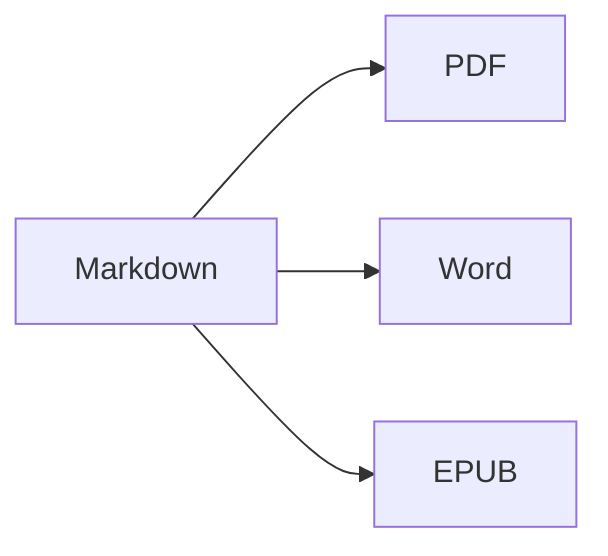

Deschideți **vizualizarea divizată** (⌘2) pentru a vedea sursa și rezultatul unul lângă altul.

## Formatarea textului

- **Aldin** – `**text**` (⌘B)
- *Cursiv* – `*text*` (⌘I)
- ~~Tăiat~~ – `~~text~~` (⇧⌘X)
- `Cod` – `` `cod` `` (⌘`)
- [Link](https://ro.wikipedia.org/wiki/Markdown) – `[text](adresă)` (⌘K)

## Titluri

`# Titlu 1` … `###### Titlu 6` (⌥⌘1 … ⌥⌘6). **Bara laterală** (⌃⌘S) le afișează ca structură.

## Liste

1. Listă numerotată (⇧⌘7)
2. Al doilea element
    - Element imbricat (indentare cu Tab)

- [x] Gata
- [ ] De făcut (⇧⌘9)

> Citat (⇧⌘')

## Tabele

| Funcție | Scurtătură |
|:--------|:--------:|
| Editor | ⌘1 |
| Vizualizare divizată | ⌘2 |
| Vizualizare finală | ⌘3 |
| Ecran complet | ⌃⌘F |

Într-un tabel, **Tab** trece la celula următoare și aliniază coloanele; **Retur** adaugă un rând.

## Cod

```swift
func greet(_ name: String) -> String {
    return "Salut, \(name)!"   // evidențiere sintaxă
}
```

## Note de subsol

Markdown acceptă note de subsol[^1].

[^1]: Textul notei apare la sfârșitul documentului — și ca notă de subsol reală în Word.

## Formule și diagrame

În linie: $e^{i\pi} + 1 = 0$

$$
\int_0^1 x^2\,dx = \frac{1}{3}
$$



## Imagini

Lipiți o captură de ecran (⌘V) sau trageți o imagine în editor: aceasta este salvată într-un dosar `images` lângă document.

## Citări și referințe

Indicați un fișier BibTeX (`.bib`) sau CSL-JSON în front matter (sau setați unul implicit în Configurări ▸ Scriere), apoi citați cu `[@key]`:

```markdown
---
bibliography: references.bib
csl: vancouver        # sau apa
---

As shown earlier [@kovacs2020, p. 5; @who2019], … @kovacs2020 found …
```

Bibliografia este adăugată la sfârșit (sau acolo unde plasați `::: {#refs}` … `:::`). **Format ▸ Citări și referințe ▸ Inserează citare…** (⌃⌘C) caută în bibliografie și adaugă referințe noi după **DOI sau ID PubMed**. Tastarea `@` propune cheile.

## Figuri, tabele numerotate și referințe încrucișate

| Format | Rezultat |
|--------|----------|
| PDF    | cuprins cu numere de pagină |
| Word   | cuprins Word real, legende |

Table: Exporturi {#tbl:exports}

@tbl:exports enumeră formatele de ieșire. Etichetați figurile cu `{#fig:name}`, ecuațiile cu `$$ … $$ {#eq:name}`, titlurile cu `# Title {#sec:name}` și faceți trimitere la ele cu `@fig:name`, `@eq:name`, `@sec:name`. `[TOC]` (sau `toc: true` în front matter) inserează un cuprins; `numbersections: true` numerotează titlurile.

## Revizuire: modificări și comentarii

Modificările urmărite și comentariile din documentele Word sunt importate ca marcaje de revizuire – și exportate înapoi în Word ca modificări urmărite și comentarii: {++inserat++}, {--șters--}, {~~vechi~>nou~~}, {==evidențiat==}{>>Un comentariu<<}. Folosiți **Editare ▸ Revizuire** pentru a le accepta sau respinge.

## Formatare live și instrumente de scriere

**Afișare ▸ Formatare live** (⌥⌘L) ascunde marcajele Markdown, cu excepția rândului pe care îl editați. Faceți clic pe numărul de cuvinte din bara de stare pentru statistici, timp de citire și obiective de scriere. Fila **Căutare** din bara laterală caută și înlocuiește în toate fișierele Markdown și text dintr-un dosar (⌥⇧⌘F).

## Import PDF, comentarii de recenzie și compararea versiunilor

**Fișier ▸ Deschide** (⌘O) deschide și un PDF ca document Markdown nou: paragrafele, titlurile și listele sunt reconstituite, numerele de rând, antetele și numerele de pagină sunt eliminate, iar paginile scanate sunt citite cu OCR. Comentariile și marcajele din PDF devin marcaje de revizuire. Sursele LaTeX (`.tex`) se deschid pentru editare așa cum sunt.

**Fișier ▸ Importă comentariile recenzentului din PDF…** citește comentariile unui PDF recenzat și îl găsește pe fiecare în sursa pe care o editați – Markdown sau LaTeX, inclusiv fișierele incluse cu `\input`. Salvați mai întâi fișierul sursă: recenzia este stocată lângă el (`<fișier>.review.json`). Fila **Comentarii** din bara laterală (**Afișare ▸ Comentarii**) le afișează; faceți clic pe unul pentru a-i selecta textul. Instrucțiunile simple precum `change "X" to "Y"`, `delete` sau `add after: "Z"` devin sugestii pe care le puteți aplica pe rând sau cu **Aplică toate** (ambele pot fi anulate); pe celelalte le puteți marca drept rezolvate, le puteți respinge sau le puteți răspunde. **Inserează ca marcaje de revizuire** transformă comentariile unei surse Markdown în marcaje de revizuire, iar **Fișier ▸ Exportă răspunsul către recenzenți…** scrie o scrisoare de răspuns în format Markdown sau Word. Pe macOS 26 cu Apple Intelligence, **Sugerează modificare (IA)** propune o modificare direct pe Mac (funcția poate fi dezactivată în Configurări ▸ Scriere ▸ Recenzie); nimic nu se aplică fără dvs.

**Fișier ▸ Compară documente…** compară două fișiere (Markdown, text, Word, PDF…); **Fișier ▸ Compară cu** compară documentul deschis cu **Ultima versiune salvată** (ultima dată când l-ați salvat chiar dvs.), o **Versiune anterioară…** sau **Clipboard**. Afișați modificările **Alăturat** sau **În text**, ignorați spațiile, majusculele sau formatarea (formatarea afectează doar compararea de pe ecran) și treceți de la o modificare la alta cu ⌘↑ / ⌘↓. **Deschide cu marcaje de revizuire** transformă diferențele în modificări pe care le puteți accepta sau respinge; **Exportă ca Word cu urmărirea modificărilor…** le salvează ca document Word.

---

**Export:** Fișier ▸ Exportă ▸ PDF (⇧⌘E), Word (⇧⌘D), HTML sau EPUB.
**Import:** Fișier ▸ Deschide (⌘O) – fișiere DOCX, DOC, RTF, PDF, TXT și MD.
