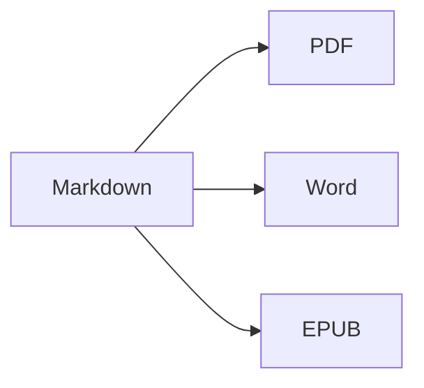

Откройте **разделенный вид** (⌘2), чтобы видеть исходный текст и результат рядом.

## Форматирование текста

- **Жирный** – `**текст**` (⌘B)
- *Курсив* – `*текст*` (⌘I)
- ~~Зачеркнутый~~ – `~~текст~~` (⇧⌘X)
- `Код` – `` `код` `` (⌘`)
- [Ссылка](https://ru.wikipedia.org/wiki/Markdown) – `[текст](адрес)` (⌘K)

## Заголовки

`# Заголовок 1` … `###### Заголовок 6` (⌥⌘1 … ⌥⌘6). **Боковая панель** (⌃⌘S) показывает их в виде структуры.

## Списки

1. Нумерованный список (⇧⌘7)
2. Второй пункт
    - Вложенный пункт (отступ клавишей Tab)

- [x] Сделано
- [ ] Сделать (⇧⌘9)

> Цитата (⇧⌘')

## Таблицы

| Функция | Сочетание клавиш |
|:--------|:--------:|
| Редактор | ⌘1 |
| Разделенный вид | ⌘2 |
| Итоговый вид | ⌘3 |
| Полноэкранный режим | ⌃⌘F |

Внутри таблицы клавиша **Tab** переходит к следующей ячейке и выравнивает столбцы; **Return** добавляет строку.

## Код

```swift
func greet(_ name: String) -> String {
    return "Привет, \(name)!"   // подсветка синтаксиса
}
```

## Сноски

Markdown поддерживает сноски[^1].

[^1]: Текст сноски отображается в конце документа — а в Word как настоящая сноска.

## Формулы и диаграммы

Встроенная: $e^{i\pi} + 1 = 0$

$$
\int_0^1 x^2\,dx = \frac{1}{3}
$$



## Изображения

Вставьте снимок экрана (⌘V) или перетащите изображение в редактор: оно будет сохранено в папку `images` рядом с документом.

## Цитирование и список литературы

Укажите файл BibTeX (`.bib`) или CSL-JSON во front matter (или задайте файл по умолчанию в Настройки ▸ Письмо), затем ссылайтесь на источники с помощью `[@key]`:

```markdown
---
bibliography: references.bib
csl: vancouver        # или apa
---

As shown earlier [@kovacs2020, p. 5; @who2019], … @kovacs2020 found …
```

Список литературы добавляется в конец документа (или туда, где стоит `::: {#refs}` … `:::`). **Формат ▸ Ссылки и литература ▸ Вставить ссылку на источник…** (⌃⌘C) ищет по списку литературы и добавляет новые источники по **DOI или PubMed ID**. При вводе `@` предлагаются ключи.

## Нумерованные рисунки, таблицы и перекрестные ссылки

| Формат | Результат |
|--------|-----------|
| PDF    | оглавление с номерами страниц |
| Word   | настоящее оглавление Word, подписи |

Table: Экспорт {#tbl:exports}

В @tbl:exports перечислены форматы вывода. Помечайте рисунки с помощью `{#fig:name}`, уравнения — `$$ … $$ {#eq:name}`, заголовки — `# Title {#sec:name}` и ссылайтесь на них с помощью `@fig:name`, `@eq:name`, `@sec:name`. `[TOC]` (или `toc: true` во front matter) вставляет оглавление; `numbersections: true` нумерует заголовки.

## Рецензирование: изменения и комментарии

Исправления и комментарии из документов Word импортируются как пометки рецензирования — и при экспорте снова сохраняются в Word как исправления и комментарии: {++вставлено++}, {--удалено--}, {~~старое~>новое~~}, {==выделено==}{>>Комментарий<<}. Принять или отклонить их можно в меню **Правка ▸ Рецензирование**.

## Живое форматирование и инструменты для письма

**Вид ▸ Живое форматирование** (⌥⌘L) скрывает разметку Markdown везде, кроме редактируемой строки. Нажмите на счетчик слов в строке состояния, чтобы увидеть статистику, время чтения и цели. Вкладка **Поиск** боковой панели ищет и заменяет текст во всех файлах Markdown и текстовых файлах папки (⌥⇧⌘F).

## Импорт PDF, комментарии рецензентов и сравнение версий

**Файл ▸ Открыть** (⌘O) открывает и PDF как новый документ Markdown: абзацы, заголовки и списки восстанавливаются, номера строк, колонтитулы и номера страниц удаляются, а отсканированные страницы распознаются с помощью OCR. Комментарии и пометки в PDF становятся пометками рецензирования. Исходные файлы LaTeX (`.tex`) открываются для редактирования без изменений.

**Файл ▸ Импортировать комментарии рецензента из PDF…** считывает комментарии из прорецензированного PDF и находит каждый из них в редактируемом Вами исходном тексте – Markdown или LaTeX, включая файлы, подключенные через `\input`. Сначала сохраните исходный файл: рецензия хранится рядом с ним (`<файл>.review.json`). Вкладка **Комментарии** боковой панели (**Вид ▸ Комментарии**) показывает их список; щелчок по комментарию выделяет соответствующий текст. Простые указания, например `change "X" to "Y"`, `delete` или `add after: "Z"`, становятся предложениями, которые можно применить по одному или кнопкой **Применить все** (и то и другое можно отменить); остальные можно отметить как выполненные, отклонить или ответить на них. **Вставить как пометки рецензирования** превращает комментарии к исходному тексту Markdown в пометки рецензирования, а **Файл ▸ Экспортировать ответ рецензентам…** создает ответное письмо в формате Markdown или Word. В macOS 26 с Apple Intelligence команда **Предложить правку (ИИ)** предлагает правку прямо на Вашем Mac (можно отключить в Настройки ▸ Письмо ▸ Рецензия); без Вас ничего не применяется.

**Файл ▸ Сравнить документы…** сравнивает два файла (Markdown, текст, Word, PDF …); **Файл ▸ Сравнить с** сравнивает открытый документ с **Последней сохраненной версией** (моментом, когда Вы в последний раз сохранили его сами), **Более ранней версией…** или **Буфером обмена**. Показывайте изменения **Рядом** или **В тексте**, не учитывайте пробелы, регистр или форматирование (форматирование влияет только на сравнение на экране) и переходите между изменениями с помощью ⌘↑ / ⌘↓. **Открыть с пометками рецензирования** превращает различия в изменения, которые можно принять или отклонить; **Экспортировать как Word с исправлениями…** сохраняет их как документ Word.

---

**Экспорт:** Файл ▸ Экспорт ▸ PDF (⇧⌘E), Word (⇧⌘D), HTML или EPUB.
**Импорт:** Файл ▸ Открыть (⌘O) – файлы DOCX, DOC, RTF, PDF, TXT и MD.
