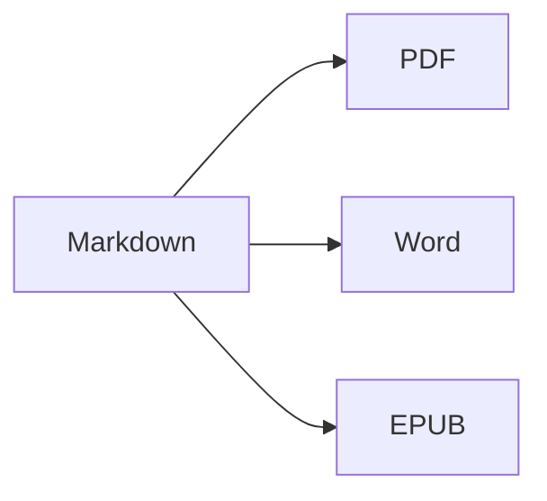

Откройте **разделенный вид** (⌘2), чтобы видеть исходный текст и результат рядом.

## Форматирование текста

- **Жирный** – `**текст**` (⌘B)
- *Курсив* – `*текст*` (⌘I)
- ~~Зачеркнутый~~ – `~~текст~~` (⇧⌘X)
- `Код` – `` `код` `` (⌘`)
- [Ссылка](https://ru.wikipedia.org/wiki/Markdown) – `[текст](адрес)` (⌘K)

## Заголовки

`# Заголовок 1` … `###### Заголовок 6` (⌥⌘1 … ⌥⌘6). **Боковая панель** (⌃⌘S) показывает их в виде структуры.

## Списки

1. Нумерованный список (⇧⌘7)
2. Второй пункт
    - Вложенный пункт (отступ клавишей Tab)

- [x] Сделано
- [ ] Сделать (⇧⌘9)

> Цитата (⇧⌘')

## Таблицы

| Функция | Сочетание клавиш |
|:--------|:--------:|
| Редактор | ⌘1 |
| Разделенный вид | ⌘2 |
| Итоговый вид | ⌘3 |
| Полноэкранный режим | ⌃⌘F |

Внутри таблицы клавиша **Tab** переходит к следующей ячейке и выравнивает столбцы; **Return** добавляет строку.

## Код

```swift
func greet(_ name: String) -> String {
    return "Привет, \(name)!"   // подсветка синтаксиса
}
```

## Сноски

Markdown поддерживает сноски[^1].

[^1]: Текст сноски отображается в конце документа — а в Word как настоящая сноска.

## Формулы и диаграммы

Встроенная: $e^{i\pi} + 1 = 0$

$$
\int_0^1 x^2\,dx = \frac{1}{3}
$$



## Изображения

Вставьте снимок экрана (⌘V) или перетащите изображение в редактор: оно будет сохранено в папку `images` рядом с документом.

---

**Экспорт:** Файл ▸ Экспорт ▸ PDF (⇧⌘E), Word (⇧⌘D), HTML или EPUB.
**Импорт:** Файл ▸ Открыть (⌘O) – файлы DOCX, DOC, RTF, TXT и MD.
