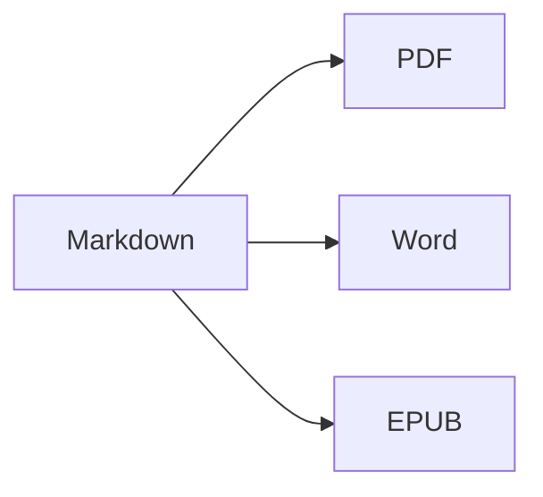

Otvorte **rozdelené zobrazenie** (⌘2) a uvidíte zdrojový text aj výsledok vedľa seba.

## Formátovanie textu

- **Tučné** – `**text**` (⌘B)
- *Kurzíva* – `*text*` (⌘I)
- ~~Prečiarknuté~~ – `~~text~~` (⇧⌘X)
- `Kód` – `` `kód` `` (⌘`)
- [Odkaz](https://en.wikipedia.org/wiki/Markdown) – `[text](adresa)` (⌘K)

## Nadpisy

`# Nadpis 1` … `###### Nadpis 6` (⌥⌘1 … ⌥⌘6). **Bočný panel** (⌃⌘S) ich zobrazuje ako osnovu.

## Zoznamy

1. Číslovaný zoznam (⇧⌘7)
2. Druhá položka
    - Vnorená položka (odsadenie klávesom Tab)

- [x] Hotovo
- [ ] Treba urobiť (⇧⌘9)

> Citát (⇧⌘')

## Tabuľky

| Funkcia | Skratka |
|:--------|:--------:|
| Editor | ⌘1 |
| Rozdelené zobrazenie | ⌘2 |
| Konečné zobrazenie | ⌘3 |
| Celá obrazovka | ⌃⌘F |

V tabuľke **Tab** preskočí do ďalšej bunky a zarovná stĺpce; **Return** pridá riadok.

## Kód

```swift
func greet(_ name: String) -> String {
    return "Ahoj, \(name)!"   // zvýraznená syntax
}
```

## Poznámky pod čiarou

Markdown podporuje poznámky pod čiarou[^1].

[^1]: Text poznámky sa zobrazí na konci dokumentu – a vo Worde ako skutočná poznámka pod čiarou.

## Vzorce a diagramy

V riadku: $e^{i\pi} + 1 = 0$

$$
\int_0^1 x^2\,dx = \frac{1}{3}
$$



## Obrázky

Vložte snímku obrazovky (⌘V) alebo do editora presuňte obrázok: uloží sa do priečinka `images` vedľa dokumentu.

## Citácie a literatúra

Vo front matter uveďte súbor BibTeX (`.bib`) alebo CSL-JSON (alebo nastavte predvolený v Nastavenia ▸ Písanie) a citujte pomocou `[@key]`:

```markdown
---
bibliography: references.bib
csl: vancouver        # alebo apa
---

As shown earlier [@kovacs2020, p. 5; @who2019], … @kovacs2020 found …
```

Zoznam literatúry sa pridá na koniec (alebo tam, kde umiestnite `::: {#refs}` … `:::`). **Formát ▸ Citácie a odkazy ▸ Vložiť citáciu…** (⌃⌘C) prehľadáva zoznam literatúry a pridáva nové zdroje podľa **DOI alebo PubMed ID**. Pri písaní `@` sa ponúknu kľúče.

## Číslované obrázky, tabuľky a krížové odkazy

| Formát | Výstup |
|--------|--------|
| PDF    | obsah s číslami strán |
| Word   | skutočný obsah Wordu, popisy |

Table: Exporty {#tbl:exports}

@tbl:exports uvádza výstupné formáty. Obrázky označte pomocou `{#fig:name}`, rovnice pomocou `$$ … $$ {#eq:name}`, nadpisy pomocou `# Title {#sec:name}` a odkazujte na ne pomocou `@fig:name`, `@eq:name`, `@sec:name`. `[TOC]` (alebo `toc: true` vo front matter) vloží obsah; `numbersections: true` očísluje nadpisy.

## Revízia: zmeny a komentáre

Sledované zmeny a komentáre z dokumentov Wordu sa importujú ako revízne značky – a pri exporte sa do Wordu vrátia ako sledované zmeny a komentáre: {++vložené++}, {--vymazané--}, {~~staré~>nové~~}, {==zvýraznené==}{>>Komentár<<}. Prijať alebo odmietnuť ich môžete v ponuke **Upraviť ▸ Revízia**.

## Živé formátovanie a nástroje na písanie

**Zobraziť ▸ Živé formátovanie** (⌥⌘L) skryje značky Markdownu okrem riadka, ktorý práve upravujete. Kliknutím na počet slov v stavovej lište zobrazíte štatistiku, čas čítania a ciele písania. Karta **Hľadanie** v bočnom paneli vyhľadáva a nahrádza vo všetkých súboroch Markdown a textových súboroch priečinka (⌥⇧⌘F).

## Import PDF, komentáre recenzenta a porovnávanie verzií

**Súbor ▸ Otvoriť** (⌘O) otvorí aj PDF ako nový dokument Markdown: odseky, nadpisy a zoznamy sa obnovia, čísla riadkov, záhlavia a čísla strán sa odstránia a naskenované strany sa prečítajú pomocou OCR. Komentáre a značky v PDF sa zmenia na revízne značky. Zdroje LaTeX (`.tex`) sa otvoria na úpravy bez zmeny.

**Súbor ▸ Importovať komentáre recenzenta z PDF…** načíta komentáre z recenzovaného PDF a každý nájde v zdroji, ktorý upravujete – v Markdowne alebo LaTeXe vrátane súborov vložených príkazom `\input`. Najprv uložte zdrojový súbor: recenzia sa ukladá vedľa neho (`<súbor>.review.json`). Karta **Komentáre** bočného panela (**Zobraziť ▸ Komentáre**) ich zobrazí; kliknutím na komentár sa vyberie jeho text. Jednoduché pokyny ako `change "X" to "Y"`, `delete` alebo `add after: "Z"` sa zmenia na návrhy, ktoré môžete použiť jednotlivo alebo tlačidlom **Použiť všetky** (oboje sa dá vrátiť); ostatné môžete označiť ako vybavené, odmietnuť alebo na ne odpovedať. **Vložiť ako revízne značky** zmení komentáre zdroja Markdown na revízne značky a **Súbor ▸ Exportovať odpoveď recenzentom…** vytvorí list s odpoveďou vo formáte Markdown alebo Word. V systéme macOS 26 s Apple Intelligence navrhne **Navrhnúť úpravu (AI)** úpravu priamo na vašom Macu (dá sa vypnúť v Nastavenia ▸ Písanie ▸ Recenzia); bez vás sa nič nepoužije.

**Súbor ▸ Porovnať dokumenty…** porovná dva súbory (Markdown, text, Word, PDF …); **Súbor ▸ Porovnať s** porovná otvorený dokument s položkou **Naposledy uložená verzia** (keď ste ho naposledy sami uložili), **Staršia verzia…** alebo **Schránka**. Zmeny zobrazte **Vedľa seba** alebo **V texte**, ignorujte medzery, veľkosť písmen alebo formátovanie (formátovanie ovplyvňuje len porovnanie na obrazovke) a medzi zmenami prechádzajte pomocou ⌘↑ / ⌘↓. **Otvoriť s revíznymi značkami** zmení rozdiely na zmeny, ktoré môžete prijať alebo odmietnuť; **Exportovať ako Word so sledovanými zmenami…** ich uloží ako dokument Wordu.

---

**Export:** Súbor ▸ Exportovať ▸ PDF (⇧⌘E), Word (⇧⌘D), HTML alebo EPUB.
**Import:** Súbor ▸ Otvoriť (⌘O) – súbory DOCX, DOC, RTF, PDF, TXT a MD.
