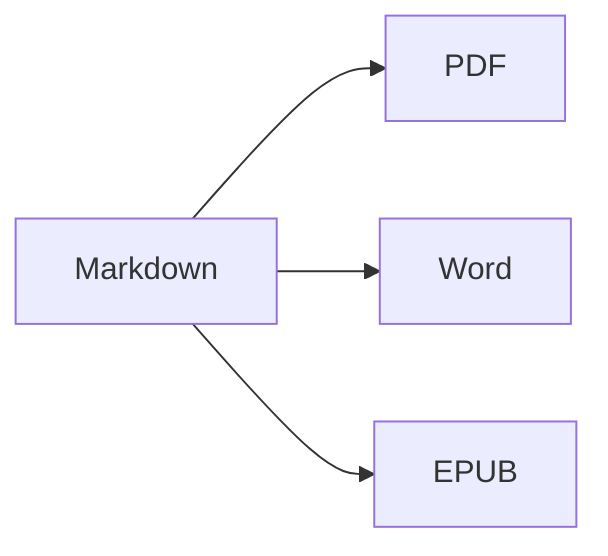

Otvorte **rozdelené zobrazenie** (⌘2) a uvidíte zdrojový text aj výsledok vedľa seba.

## Formátovanie textu

- **Tučné** – `**text**` (⌘B)
- *Kurzíva* – `*text*` (⌘I)
- ~~Prečiarknuté~~ – `~~text~~` (⇧⌘X)
- `Kód` – `` `kód` `` (⌘`)
- [Odkaz](https://en.wikipedia.org/wiki/Markdown) – `[text](adresa)` (⌘K)

## Nadpisy

`# Nadpis 1` … `###### Nadpis 6` (⌥⌘1 … ⌥⌘6). **Bočný panel** (⌃⌘S) ich zobrazuje ako osnovu.

## Zoznamy

1. Číslovaný zoznam (⇧⌘7)
2. Druhá položka
    - Vnorená položka (odsadenie klávesom Tab)

- [x] Hotovo
- [ ] Treba urobiť (⇧⌘9)

> Citát (⇧⌘')

## Tabuľky

| Funkcia | Skratka |
|:--------|:--------:|
| Editor | ⌘1 |
| Rozdelené zobrazenie | ⌘2 |
| Konečné zobrazenie | ⌘3 |
| Celá obrazovka | ⌃⌘F |

V tabuľke **Tab** preskočí do ďalšej bunky a zarovná stĺpce; **Return** pridá riadok.

## Kód

```swift
func greet(_ name: String) -> String {
    return "Ahoj, \(name)!"   // zvýraznená syntax
}
```

## Poznámky pod čiarou

Markdown podporuje poznámky pod čiarou[^1].

[^1]: Text poznámky sa zobrazí na konci dokumentu – a vo Worde ako skutočná poznámka pod čiarou.

## Vzorce a diagramy

V riadku: $e^{i\pi} + 1 = 0$

$$
\int_0^1 x^2\,dx = \frac{1}{3}
$$



## Obrázky

Vložte snímku obrazovky (⌘V) alebo do editora presuňte obrázok: uloží sa do priečinka `images` vedľa dokumentu.

---

**Export:** Súbor ▸ Exportovať ▸ PDF (⇧⌘E), Word (⇧⌘D), HTML alebo EPUB.
**Import:** Súbor ▸ Otvoriť (⌘O) – súbory DOCX, DOC, RTF, TXT a MD.
