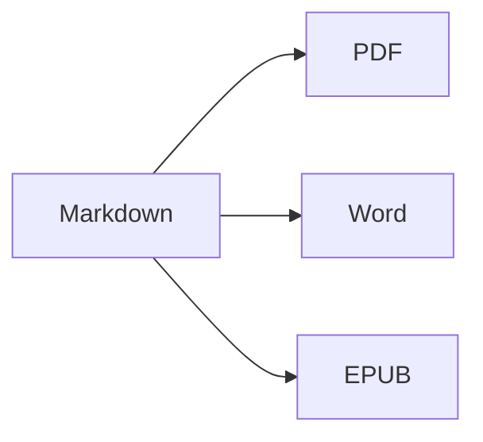

Kaynağı ve sonucu yan yana görmek için **bölünmüş görünümü** (⌘2) açın.

## Metin biçimlendirme

- **Kalın** – `**metin**` (⌘B)
- *İtalik* – `*metin*` (⌘I)
- ~~Üstü çizili~~ – `~~metin~~` (⇧⌘X)
- `Kod` – `` `kod` `` (⌘`)
- [Bağlantı](https://tr.wikipedia.org/wiki/Markdown) – `[metin](adres)` (⌘K)

## Başlıklar

`# Başlık 1` … `###### Başlık 6` (⌥⌘1 … ⌥⌘6). **Kenar çubuğu** (⌃⌘S) bunları ana hat olarak listeler.

## Listeler

1. Numaralı liste (⇧⌘7)
2. İkinci öğe
    - İç içe öğe (Sekme ile girintileyin)

- [x] Tamamlandı
- [ ] Yapılacak (⇧⌘9)

> Alıntı (⇧⌘')

## Tablolar

| Özellik | Kısayol |
|:--------|:--------:|
| Düzenleyici | ⌘1 |
| Bölünmüş görünüm | ⌘2 |
| Son görünüm | ⌘3 |
| Tam ekran | ⌃⌘F |

Tablo içinde **Sekme** bir sonraki hücreye geçer ve sütunları hizalar; **Return** yeni bir satır ekler.

## Kod

```swift
func greet(_ name: String) -> String {
    return "Merhaba, \(name)!"   // sözdizimi vurgulanır
}
```

## Dipnotlar

Markdown dipnotları destekler[^1].

[^1]: Dipnot metni belgenin sonunda görünür — Word’de ise gerçek bir dipnot olarak.

## Formüller ve diyagramlar

Satır içi: $e^{i\pi} + 1 = 0$

$$
\int_0^1 x^2\,dx = \frac{1}{3}
$$



## Resimler

Bir ekran görüntüsü yapıştırın (⌘V) veya bir resmi düzenleyiciye sürükleyin: resim, belgenin yanındaki `images` klasörüne kaydedilir.

---

**Dışa aktarma:** Dosya ▸ Dışa Aktar ▸ PDF (⇧⌘E), Word (⇧⌘D), HTML veya EPUB.
**İçe aktarma:** Dosya ▸ Aç (⌘O) – DOCX, DOC, RTF, TXT ve MD dosyaları.
