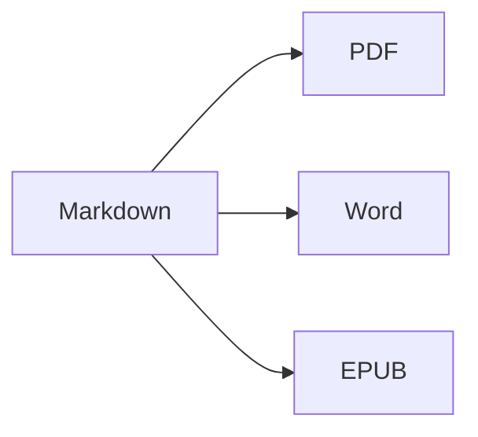

Kaynağı ve sonucu yan yana görmek için **bölünmüş görünümü** (⌘2) açın.

## Metin biçimlendirme

- **Kalın** – `**metin**` (⌘B)
- *İtalik* – `*metin*` (⌘I)
- ~~Üstü çizili~~ – `~~metin~~` (⇧⌘X)
- `Kod` – `` `kod` `` (⌘`)
- [Bağlantı](https://tr.wikipedia.org/wiki/Markdown) – `[metin](adres)` (⌘K)

## Başlıklar

`# Başlık 1` … `###### Başlık 6` (⌥⌘1 … ⌥⌘6). **Kenar çubuğu** (⌃⌘S) bunları ana hat olarak listeler.

## Listeler

1. Numaralı liste (⇧⌘7)
2. İkinci öğe
    - İç içe öğe (Sekme ile girintileyin)

- [x] Tamamlandı
- [ ] Yapılacak (⇧⌘9)

> Alıntı (⇧⌘')

## Tablolar

| Özellik | Kısayol |
|:--------|:--------:|
| Düzenleyici | ⌘1 |
| Bölünmüş görünüm | ⌘2 |
| Son görünüm | ⌘3 |
| Tam ekran | ⌃⌘F |

Tablo içinde **Sekme** bir sonraki hücreye geçer ve sütunları hizalar; **Return** yeni bir satır ekler.

## Kod

```swift
func greet(_ name: String) -> String {
    return "Merhaba, \(name)!"   // sözdizimi vurgulanır
}
```

## Dipnotlar

Markdown dipnotları destekler[^1].

[^1]: Dipnot metni belgenin sonunda görünür — Word’de ise gerçek bir dipnot olarak.

## Formüller ve diyagramlar

Satır içi: $e^{i\pi} + 1 = 0$

$$
\int_0^1 x^2\,dx = \frac{1}{3}
$$



## Resimler

Bir ekran görüntüsü yapıştırın (⌘V) veya bir resmi düzenleyiciye sürükleyin: resim, belgenin yanındaki `images` klasörüne kaydedilir.

## Atıflar ve kaynaklar

Front matter içinde bir BibTeX (`.bib`) veya CSL-JSON dosyası belirtin (ya da Ayarlar ▸ Yazma bölümünde varsayılan bir dosya ayarlayın), ardından `[@key]` ile atıf yapın:

```markdown
---
bibliography: references.bib
csl: vancouver        # veya apa
---

As shown earlier [@kovacs2020, p. 5; @who2019], … @kovacs2020 found …
```

Kaynak listesi belgenin sonuna (veya `::: {#refs}` … `:::` koyduğunuz yere) eklenir. **Biçim ▸ Atıflar ve Kaynaklar ▸ Atıf Ekle…** (⌃⌘C) kaynakçada arama yapar ve **DOI veya PubMed kimliği** ile yeni kaynaklar ekler. `@` yazdığınızda anahtarlar önerilir.

## Numaralı şekiller, tablolar ve çapraz başvurular

| Biçim | Çıktı |
|-------|-------|
| PDF   | sayfa numaralı içindekiler |
| Word  | gerçek Word içindekiler tablosu, alt yazılar |

Table: Dışa aktarımlar {#tbl:exports}

@tbl:exports çıktı biçimlerini listeler. Şekilleri `{#fig:name}`, denklemleri `$$ … $$ {#eq:name}`, başlıkları `# Title {#sec:name}` ile etiketleyin ve bunlara `@fig:name`, `@eq:name`, `@sec:name` ile başvurun. `[TOC]` (veya front matter içinde `toc: true`) içindekiler ekler; `numbersections: true` başlıkları numaralandırır.

## Gözden geçirme: değişiklikler ve yorumlar

Word belgelerindeki izlenen değişiklikler ve yorumlar gözden geçirme işaretleri olarak içe aktarılır ve Word’e yeniden izlenen değişiklikler ve yorumlar olarak dışa aktarılır: {++eklendi++}, {--silindi--}, {~~eski~>yeni~~}, {==vurgulandı==}{>>Bir yorum<<}. Bunları kabul etmek veya reddetmek için **Düzen ▸ Gözden Geçir** menüsünü kullanın.

## Canlı biçimlendirme ve yazma araçları

**Görüntü ▸ Canlı Biçimlendirme** (⌥⌘L), düzenlediğiniz satır dışında Markdown işaretlemesini gizler. İstatistikler, okuma süresi ve yazma hedefleri için durum çubuğundaki kelime sayısını tıklayın. Kenar çubuğundaki **Ara** sekmesi, bir klasördeki tüm Markdown ve metin dosyalarında arama yapar ve değiştirir (⌥⇧⌘F).

## PDF içe aktarma, hakem yorumları ve sürümleri karşılaştırma

**Dosya ▸ Aç** (⌘O) bir PDF’i de yeni bir Markdown belgesi olarak açar: paragraflar, başlıklar ve listeler yeniden oluşturulur, satır numaraları, sayfa üst bilgileri ve sayfa numaraları kaldırılır, taranmış sayfalar OCR ile okunur. PDF’teki yorumlar ve işaretlemeler gözden geçirme işaretlerine dönüşür. LaTeX kaynakları (`.tex`) olduğu gibi düzenlenmek üzere açılır.

**Dosya ▸ Hakem Yorumlarını PDF’ten İçe Aktar…** hakem yorumlu bir PDF’in yorumlarını okur ve her birini düzenlediğiniz kaynakta bulur – Markdown veya LaTeX, `\input` ile eklenen dosyalar dahil. Önce kaynak dosyayı kaydedin: değerlendirme onun yanında saklanır (`<dosya>.review.json`). Kenar çubuğunun **Yorumlar** sekmesi (**Görüntü ▸ Yorumlar**) bunları listeler; metnini seçmek için bir yoruma tıklayın. `change "X" to "Y"`, `delete` veya `add after: "Z"` gibi basit talimatlar, tek tek ya da **Tümünü Uygula** ile uygulayabileceğiniz önerilere dönüşür (ikisi de geri alınabilir); diğerlerini tamamlandı olarak işaretleyebilir, reddedebilir veya yanıtlayabilirsiniz. **Gözden Geçirme İşaretleri Olarak Ekle** bir Markdown kaynağının yorumlarını gözden geçirme işaretlerine dönüştürür; **Dosya ▸ Hakemlere Yanıtı Dışa Aktar…** ise Markdown veya Word biçiminde bir yanıt mektubu yazar. Apple Intelligence bulunan macOS 26’da **Düzenleme Öner (YZ)** doğrudan Mac’inizde bir düzenleme önerir (Ayarlar ▸ Yazma bölümünden açın); siz onaylamadan hiçbir şey uygulanmaz.

**Dosya ▸ Belgeleri Karşılaştır…** iki dosyayı karşılaştırır (Markdown, metin, Word, PDF …); **Dosya ▸ Şununla Karşılaştır** açık belgeyi **Son Kaydedilen Sürüm** (en son kendiniz kaydettiğiniz an), bir **Önceki Sürüm…** veya **Pano** ile karşılaştırır. Değişiklikleri **Yan Yana** veya **Satır İçi** gösterin; boşlukları, büyük/küçük harfi veya biçimlendirmeyi yok sayın (biçimlendirme yalnızca ekrandaki karşılaştırmayı etkiler) ve değişiklikler arasında ⌘↑ / ⌘↓ ile geçin. **Gözden Geçirme İşaretleriyle Aç** farkları kabul edebileceğiniz veya reddedebileceğiniz değişikliklere dönüştürür; **Değişiklik İzlemeli Word Olarak Dışa Aktar…** bunları Word belgesi olarak kaydeder.

---

**Dışa aktarma:** Dosya ▸ Dışa Aktar ▸ PDF (⇧⌘E), Word (⇧⌘D), HTML veya EPUB.
**İçe aktarma:** Dosya ▸ Aç (⌘O) – DOCX, DOC, RTF, PDF, TXT ve MD dosyaları.
